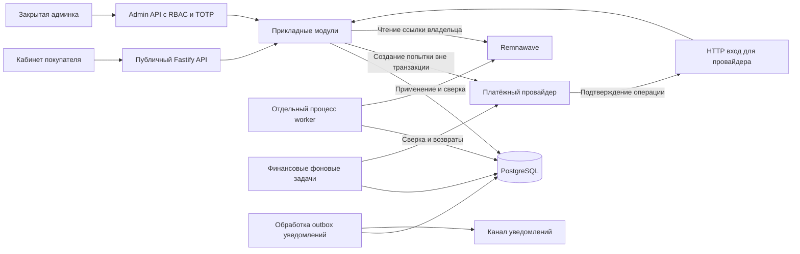

# MZT / VPNShop · Архитектура

Магазин приватного VPN-доступа. Стартовый объём — один доступ на аккаунт, ручная покупка и продление на 1, 3 или 6 календарных месяцев, один подтверждённый платёжный канал, выдача через Remnawave, кабинет и закрытая админка. По заказу можно проследить деньги, оплаченный период и подтверждённое состояние доступа. [Дорожная карта](roadmap.md)

Консолидированный проект архитектурной Phase 7. Базовый срез документации — `92449af`, срез исходников из аудита — `e036d19`. Статусы ниже отделяют локальные доказательства от будущих требований. Независимая архитектурная Phase 8 остаётся открытой. [Аудит](audit.md)

## Топология

Сохраняем TypeScript и монорепозиторий для общих публичных DTO и согласованных релизов, Fastify для HTTP, Prisma для моделей и транзакций, PostgreSQL для ограничений, блокировок и устойчивой очереди. Параметризованный SQL оправдан для конкурентного захвата задач и индексов, которых не выражает используемая версия Prisma. Worker получает отдельную точку входа и управляемый жизненный цикл в том же релизе. Масштабирование API тогда не изменит число исполнителей. Оснований добавлять отдельный брокер или базы на модуль по результатам аудита нет. [ADR 0001](adr/0001-modular-monolith.md)

## Владение данными и разрешённые зависимости

В таблице указаны **исходящие** вызовы модулей. Чужие таблицы изменяются только через команды владельца. Один прикладной сценарий может передать общий контекст транзакции нескольким командам. Для чтения Support и кабинета разрешены именованные read-only проекции. Сырые записи Prisma, ключи и клиенты провайдеров остаются внутри backend.

| Модуль | Чем владеет | Разрешённые вызовы и интерфейсы |
|---|---|---|
| Identity | Учётные данные, внешние идентификаторы, обычные и административные сессии | Возвращает principal с ID, типом сессии и правами. Другие модули используют ID. Отзыв привилегированных сессий и незавершённой привязки входит в контракт восстановления. |
| Catalog | Код, описание, доступность продукта, состав возможностей | Публикует описание тарифа и правила совместимости ограничений. Историю заказа не редактирует. |
| Pricing | Версии предложения, срок, валюта, сумма, ограничения, окно продажи | Читает Catalog. Публикует новую неизменяемую версию; предоставляет Orders команду получения действующих условий под транзакционной защитой. |
| Orders | Владелец заказа, снимок, окно оплаты, существование единственного зачтённого платежа | Читает Pricing и ID principal. Команды createOrder, allocateCapture и expireOrder. Передача одного заказа на исполнение определяется уникальной аллокацией. |
| Payments | Merchant account, попытка, финансовые события, движения, возвраты, сверка | Адаптеры изолируют сеть. Передаёт проверенный финансовый факт прикладному сценарию. Никаких вызовов Remnawave. |
| Subscriptions | Подтверждённое право, периоды, корректировки, блокировки и версии желаемого назначения | Принимает снимок и подтверждённую аллокацию, команды grant, adjust, block, unblock. Выдаёт проекцию для конкретного момента и следующее время изменения. |
| Fulfillment | Задачи, аренды, номера попыток, наблюдения, очередь повторной сверки | Читает текущее назначение Subscriptions. Вызывает Remnawave integration. Принимает команды ensureSync и reconcile. Завершение не меняет финансовую историю. |
| Remnawave integration | Контракт панели, сопоставление внешних ID, нормализация ошибок | Операции readAccount, applyDesired, readLink. Секреты доступны только backend. Ограничения адаптера подтверждаются контрактными и стендовыми тестами. |
| Administration | HTTP-точка входа для управляющих команд | Проверяет Identity и право на конкретное действие. Вызывает команды Catalog, Pricing, Payments, Subscriptions, Fulfillment. Тариф, ручная компенсация и requeue отражаются в Audit. |
| Audit | Неизменяемая запись «кто, что, когда, почему», ID корреляции и результата | append в той же транзакции, что и изменение. Для внешней операции отдельные записи о намерении и подтверждении. Доступ на чтение ограничен ролью. |
| Notifications | Задание доставки, шаблон, адресат, попытки, факт доставки | Читает outbox после commit; дедупликация по событию, каналу и адресату. Сбой доставки не отменяет оплату или начисление. |
| Support | Операторская проекция и история обращения с причиной расхождения | Читает разрешённые представления Orders, Payments, Subscriptions, Fulfillment. SUPPORT по умолчанию имеет чтение. Управляющие действия идут через Administration с причинами и полномочиями. |

Координатор подтверждения платежа находится на прикладном уровне и последовательно вызывает Payments, Orders, Subscriptions, Fulfillment, Audit и outbox. Модули не вызывают координатор обратно. Обратные зависимости запрещаются проверкой импортов по границам пакета/директорий при реализации. Shared содержит версионированные DTO, коды ошибок и схемы ввода. Правила признания денег и расчёта срока имеют единственную серверную реализацию.

## Тариф, предложение и заказ

| Вариант стартового каталога | Единица продажи | Что задаёт версия |
|---|---|---|
| 1 месяц | Одно продление на 1 календарный месяц UTC | Цена в выбранной валюте, устройства, ограничения и политика срока |
| 3 месяца | Одно продление на 3 календарных месяца UTC | Самостоятельная цена и версия. Скидка определяется публикацией |
| 6 месяцев | Одно продление на 6 календарных месяцев UTC | Самостоятельная цена и версия |

Срок — положительный параметр предложения. Новый срок, валюта, уровень доступа или группа серверов добавляются публикацией совместимой версии. Для MVP разрешены только ограничения, которые адаптер панели умеет применить и прочитать обратно. При публикации проверяются единицы, диапазоны и комбинации, включая лимит устройств, трафик, стратегию сброса и профиль доступа/squads. Пропущенное поле и «без лимита» имеют разные явные значения.

1. ADMIN публикует OfferVersion с ID и возрастающим номером внутри предложения, интервалом продажи UTC и версией политики. Опубликованные коммерческие поля неизменяемы. Снятие с продажи закрывает новые заказы. Редактирование цены создаёт новую версию.
2. Каталог возвращает доступные варианты и ID версии. Клиент отправляет ID версии и Idempotency-Key. Полученные из клиента сумма, валюта или лимиты отвергаются. В одной транзакции Orders проверяет владельца ключа и хеш запроса, действительность цены и тарифа на время БД, записывает снимок и ответ. Публикация/снятие с продажи и проверка активной версии сериализуются по строке предложения. Устаревшая версия даёт конфликт с предложением обновить каталог.
3. Снимок содержит ID/версию предложения и тарифа, отображаемое название, сумму в минимальных единицах и валюту, срок в месяцах, устройства, версионированные дополнительные ограничения, версию правил расчёта/возврата, время фиксации и expiresAt. Снимок нельзя переопределить при оплате, продлении и последующих изменениях каталога.
4. Сервер вычисляет expiresAt как минимум конца доступного окна и времени создания плюс настроенный TTL. Число минут и возможность выключить уже выданные предложения — решения владельца. Ключ уникален по пользователю и операции. Повтор возвращает первоначальный заказ, включая истёкший; изменённое тело с тем же ключом даёт 409. Для новой покупки нужен новый ключ. При повторе после сетевого таймаута lookup ключа предшествует повторной проверке цены.

**Переходы заказа.** OPEN → ALLOCATED при первом зачтённом захвате средств, OPEN → EXPIRED по часам БД, OPEN → CANCELED по допустимой отмене до зачёта. EXPIRED → ALLOCATED разрешён только для проверенной своевременной оплаты с запоздалой доставкой события либо явно одобренного урегулирования. CANCELED с поступившими деньгами открывает разбор. ALLOCATED остаётся историческим фактом после возврата. Состояния платежа, возврата и доступа выводятся в карточке заказа отдельно. Повторная доставка предыдущего статуса не откатывает переход.

## Точки входа и транзакции

| Интерфейс | Граница доступа и результат |
|---|---|
| GET /api/plans, POST /api/orders, GET /api/orders/:id | Цены публичны, заказ привязан к авторизованному владельцу на каждом чтении/изменении. Ответ содержит только поля кабинета. |
| POST /api/orders/:id/payments | Владелец и открытый заказ. Проверяются ключ, выбранный канал и неизменность снимка. Возвращает ID попытки и разрешённое следующее действие. |
| POST /webhooks/:provider/:account | Отдельная точка вне браузерной cookie-аутентификации. Маршрут выбирает конфигурацию аккаунта, доверие устанавливает адаптер. [Протокол обработки](payments.md) |
| GET /api/me/subscription и POST /api/me/subscription/access | Статус с временем наблюдения доступен владельцу с живой сессией. Ссылка раскрывается отдельным действием с проверкой Origin, срока, права, привязки, профиля панели и повторной проверкой локального состояния. Ответ no-store. [C1/C4](user-account.md#контракты-кабинета) |
| Закрытый Admin API | Поиск по заказу, merchant reference, транзакции или ID клиента. ADMIN публикует цену, открывает возврат, оформляет корректировку и requeue. SUPPORT видит причину, суммы, время и статус, без токенов, ссылок и полных payload. |
| Внутренние события | Идентификатор события, тип, версия схемы, агрегат и версия, correlationId, время. Outbox пишется с бизнес-изменением. Повторная доставка ожидаема; каждый потребитель фиксирует свой уникальный факт обработки. |

**Общий порядок блокировок** для всех пишущих сценариев — строка заказа, затем связанные попытки и исходные финансовые операции (по стабильному ID), затем подписка пользователя, затем задание. Заказ с неизвестным владельцем события сначала сопоставляется по доверенному merchant reference. Если целевой заказ ещё не установлен, событие сохраняется в inbox и ждёт разбора. Административная операция только над подпиской берёт её строку и не пытается затем захватить заказ. Рабочий процесс берёт lease отдельной короткой транзакцией, освобождает SQL-блокировки до HTTP и при фиксации использует общий порядок. Вставка отсутствующего агрегата защищена уникальным ключом и повторным чтением после конфликта. Deadlock/serialization failure требует ограниченного повтора всей локальной команды с тем же ID. Сеть никогда не держит транзакцию БД открытой.

| Операция | Что коммитится вместе | Граница сбоя, восстановление и проверка |
|---|---|---|
| Публикация и заказ | Версия с аудитом; отдельно заказ со снимком и ключом | Одновременное снятие цены и оформление дают либо полный действовавший снимок, либо конфликт. Два запроса с одним ключом возвращают один ID. |
| Признание оплаты | Финансовая операция, аллокация, один grant, обновление назначения, задача, processed inbox и outbox | При асинхронном приёме ACK следует после устойчивого RECEIVED в inbox, отдельный commit учитывает деньги и PROCESSED. При синхронном учёте ACK следует после commit учёта. Повтор до и после каждого commit проверяется отдельно. [Протокол](payments.md#жизненный-цикл-и-отказы) |
| Возврат и корректировка | Намерение с резервом возвратной суммы фиксируется до HTTP; подтверждённое движение, освобождение резерва, решение по праву и audit — в следующем commit | Потеря ответа ведёт в сверку; новая попытка требует известного исхода. Тест — возврат между отправкой и подтверждением выдачи. |
| Блокировка и восстановление | Причина, actor, право, назначение новой версии, задача, audit | Кабинет прекращает выдавать ссылку с первого commit. Ранее импортированный доступ зависит от применения состояния панелью. Проверить отказ панели и время фактической блокировки. |
| Отправка уведомления | Устойчивое намерение доставки с бизнес-событием, результат доставки отдельно | При таймауте использовать идентификатор сообщения, если канал поддерживает. Иначе возможен повтор письма. Проверить сбой после отправки и отсутствие повторного начисления. |
| Разбор поддержкой | Чтение по роли; ручное решение — команда с ключом, причиной и аудитом | Повтор клика не создаёт вторую компенсацию. Проверить отказ SUPPORT, неизменность данных при ошибке аудита и видимость результата оператору. |

## Изменения данных и совместимость

Исходная Prisma schema содержит изменяемые Plan и PlanPrice, снимок четырёх полей в Order, Payment с необязательным externalId, WebhookEvent, User.remnawaveUserId и FulfillmentJob с уникальным orderId и targetExpireAt. Истории миграций в проверенном Git нет. Новая схема должна сохранять эти источники до сверки. [Исходные модели](../apps/api/prisma/schema.prisma#L219)

| Текущая модель | Предлагаемое дополнение и ключевые индексы |
|---|---|
| Plan / PlanPrice | OfferVersion: уникальный (offerId, version), период публикации, снимок политики, сумма и валюта. Индекс каталога по продукту и окну действия. В БД исключить неоднозначную активную версию одного варианта. |
| Order | orderSnapshot, offerVersionId, state, policyVersion, ключ и fingerprint. UNIQUE(userId, operation, idempotencyKey). Индексы владельца по createdAt и открытых заказов по expiresAt. Запрет изменения снимка после создания на уровне записывающей роли/БД. |
| Payment / WebhookEvent | PaymentAttempt, PaymentTransaction, ProviderEvent, OrderAllocation, Refund, ReconciliationCase с составными ключами аккаунта и среды. Денежные значения целочисленные с проверками диапазона; агрегаты используют точную арифметику. [Ключи и индексы](payments.md) |
| User / продление | Subscription UNIQUE(userId) в первой версии, PeriodGrant с уникальным источником, Adjustment, ServiceHold, DesiredAssignment и PanelObservation. Индексы по подписке и границам времени; уникальность (subscriptionId, revision). Наблюдения по времени и привязке панели. |
| FulfillmentJob | SyncJob с целью (subscriptionId, revision) и nextRunAt. Lease owner/token/until принадлежат общему курсору подписки для всех ревизий. Причина заказа хранится как ссылка. Повторная сверка **той же версии** переоткрывает её задачу с новым token. Индексы частичные по готовым, истёкшим арендам и сроку следующей проверки. |
| AuditLog | Добавить commandId, correlationId, ссылки на финансовую операцию, actor и причину. Outbox, delivery и обработанные события уникальны по ключам потребителя. Ограничить права редактирования истории и определить срок хранения персональных данных. |

### Миграция и возврат версии

1. **Инвентаризация и репетиция.** Снять резервную копию и восстановить на отдельном экземпляре. Сопоставить реальную схему с Git, типы и валюты, дубликаты externalId, доли NULL, количество заказов по статусам, суммы по валюте/провайдеру, открытые задачи, связи User с панелью и ручные блокировки. Проверить доступ к ключам TOTP. Снять исходные показатели и согласовать окна остановки. Baseline Prisma вводится только после подтверждения фактической схемы.
2. **Расширение.** Добавить совместимые таблицы/nullable-ссылки и индексы без изменения старых читателей. Индексы на больших таблицах строить с контролем блокировок, ограничения валидировать после backfill. Старая и новая версии должны запускаться на расширенной схеме. Проверить миграцию чистой БД и копии существующей.
3. **Backfill с контрольной точкой.** Идемпотентные партии по первичному ключу с source ID и таблицей соответствий. Историческим заказам переносить фактические четыре поля; неизвестную версию, имя и дополнительные условия маркировать legacy/unknown. Текущий PlanPrice не доказывает прошлую цену. Исторический Payment переносить как попытку; PAID/REFUNDED без доказательства конкретного движения пометить для сверки, не создавать фиктивные capture/refund. Дедуплицированные записи о старых событиях сохранить.
4. **Перенос прав и незавершённой работы.** Подтверждённые привязки сверить по внешнему ID и username, статусу, лимитам и сроку. Там, где истории недостаточно, создать явно помеченный opening balance права на момент среза, с происхождением и независимой проверкой оператора. Старые FULFILLED связываются как уже учтённые в исходном остатке. PAID с сохранённым targetExpireAt сверяется чтением панели до любого повторного применения; неоднозначность, FAILED, DISABLED или конфликт ID идут в список разбора. Сверить также пользователей без текущих заказов и операции после начала backfill.
5. **Переключение.** Теневое чтение и сравнение по пользователям и денежным итогам. Затем кратко остановить новые коммерческие записи/старого воркера, дождаться исхода отправленных запросов, буферизовать входящие события в durable inbox либо получить гарантированный повтор провайдера. Догнать изменения до зафиксированной контрольной точки. Переключить единственного писателя, начать с ограниченной группы. Критерий — ноль необъяснённых денежных расхождений, двойных grant и потерянных задач; спорные права изолированы и назначены оператору.
6. **Rollback.** До первого нового внешнего эффекта можно вернуть старые чтения/worker за флагом. После новых захватов, возвратов или изменений панели деньги и панель назад по снимку БД не откатываются. При аварии остановить писателя и выдачу, продолжать приём inbox, сверить журнал от контрольной точки. Старый писатель допустим только для данных, доказанно представимых старой схемой и перенесённых обратно; иначе режим чтения и исправление вперёд. На копии отрепетировать оба сценария, включая callback во время переключения. Удаление legacy-полей — отдельный релиз после окна наблюдения, резервной копии и проверки восстановления.

**Контроль переноса по старым статусам.** PENDING с открытой попыткой сохраняет merchant reference, если её происхождение доказано; при неизвестном исходе повторное выставление счёта блокируется до сверки. EXPIRED/CANCELED сами по себе не доказывают отсутствие денег — сравнить со списком поступлений за окно. REFUNDED без суммы, даты или исходного захвата остаётся legacy-фактом с делом на сверку. Старую RUNNING нельзя передать новому worker только по признаку истёкшей аренды: остановить прежнего писателя и прочитать состояние панели. Для старых PAID/DONE и PAID без задачи сравнить targetExpireAt, действующий профиль и историю, зафиксировать основание решения об учёте. Повтор backfill на том же снимке должен дать ноль дополнительных денег, grant и внешних команд. Стендовый rollback проверяет в том числе данные одного старого и одного нового покупателя до и после переключения.

## Контроль системных границ

| Граница | Нормативный контракт и инварианты | Проверяемое доказательство |
|---|---|---|
| Commerce → Subscriptions | Провайдерский CAPTURE проверяется без участия браузера. Попытка CREATED → SUBMITTING → AWAITING_CUSTOMER/PROCESSING либо UNKNOWN до сверки, SUCCEEDED — по подтверждённым деньгам. Неуспешные исходы отражаются отдельно. Заказ OPEN/ALLOCATED/EXPIRED/CANCELED, refund, спор и выдача имеют собственные состояния. Каждый реальный capture сохраняется, аллокация и grant максимум по одному на заказ. Сериализовать начисления на подписке по часам БД, UTC календарные месяцы и полуоткрытые интервалы. Возврат добавляет движение и отдельно корректирует право, сохраняя историю и законные последующие периоды. | Матрица повторов webhook, двух captures, неизвестного результата, неверной суммы, возвратов и продлений. [Платежи](payments.md) · [Подписки](subscriptions.md) · [CI](testing.md#матрица-критических-сценариев) |
| Subscriptions → Fulfillment → Remnawave | БД хранит право и абсолютную цель отдельно от наблюдения. Общий lease на подписку, token и revision защищают локальный commit. Поздний HTTP на панели без CAS обнаруживается повторным чтением. При неизвестной записи сначала read-back, затем актуальный абсолютный профиль, backoff и сверка CONFIRMED. Несогласованный DISABLED/MISSING удерживается для оператора. | Контракт 3.4.17 для 3.4.9, потеря ответа, старый worker, дрейф после CONFIRMED и стенд конкретной версии. [Remnawave](remnawave-integration.md) · [ADR 0003](adr/0003-panel-convergence.md) |
| Identity → web/admin → Audit | Разные origins и типы сессий. Приватные запросы разрешаются только живому principal. ADMIN и SUPPORT проверяются backend по праву и объекту, SUPPORT по умолчанию читает. Операторские команды с step-up, целью, причиной и идемпотентным ключом фиксируют audit в commit. TOTP, стадии и recovery одноразовые. Telegram входит отдельным допуском. | Отзыв сессии, BOLA, RBAC, CSRF, конкурентный TOTP, конфликт команды. [Identity](identity.md) · [Admin](admin.md) · [Безопасность](security.md) |
| API → экраны | Кабинет использует C1–C11, админка A1–A13. Сумма/валюта по снимку. Оплата, наблюдение и факт подключения разделены. C4 только при явном запросе владельца, no-store, QR локальный. Графический UX использует разрешённые DTO и не заменяет бизнес-проверки. | Состояния MZT, права, секреты, accessibility и responsive. [Кабинет](user-account.md) · [Admin](admin.md) · [Frontend](frontend.md) |
| PostgreSQL → runtime и восстановление | Один VPS, публичный и закрытый TLS входы, PostgreSQL только во внутренних сетях, отдельные API и фоновые процессы. Миграции expand/backfill/contract с проверкой legacy. Независимые readiness, heartbeat, возраст очереди и отчёты сверки. Зашифрованные off-site backups и непрерывный WAL, восстановление на отдельном экземпляре с финансовым replay и проверкой панели до мутаций. | Репетиции миграций и restore с замеренными RPO/RTO, метрики, внешние ACL и smoke. [Развёртывание](deployment.md) · [Эксплуатация](operations.md) |

## Карта спецификаций

Все запрошенные документы и три ADR присутствуют. Ниже «проект» означает спецификацию, применимую как источник реализации. Исторические проверки привязаны к отражённому в источнике срезу. Противоречия обозначены ID из реестра.

| Источник и актуальность | Владеет решением и связан с | Открытое или расхождение |
|---|---|---|
| [Audit](audit.md), исторический | Наблюдения кода, приоритеты и результаты проверок. Используют Security, Testing, Roadmap. | C1–C4, актуальный прогон впереди. |
| [Architecture](architecture.md), Phase 7 | Границы модулей, транзакции и индекс норм, опирается на ADR и доменные документы. | A1–A4 согласованы здесь. B1–B4 требуют допуска. |
| [Roadmap](roadmap.md), Phase 7 | Порядок работ, зависимости, доказательства и критерии запуска. | Независимая проверка Phase 8, затем реализация. |
| [Subscriptions](subscriptions.md), проект | Локальные периоды, правила UTC, удержания и корректировки, связано с Payments и Remnawave. | B2, B3, стендовые C2/C3. |
| [Payments](payments.md), проект | Движения, попытки, возвраты, inbox и сверка, связано с Orders, Subscriptions и Admin. | A4 согласовано с обзором, B1/B2 и C4. |
| [Remnawave](remnawave-integration.md), проект плюс проверенный контракт | Версия API, абсолютная цель, общая аренда, read-back, владелец ссылки. | Уточняет A1/A2, версия панели владельца и отсутствие CAS — B3/C2. |
| [Admin](admin.md), проект | Матрица разрешений, команды, рабочие проекции и аудит, связан с Identity и Payments. | B1/B2/B4, C3. |
| [User account](user-account.md), проект | C1–C11, владельцы, оплата и выдача, способы входа. | Уточняет A1, зависит от C2–C4. |
| [Identity](identity.md), проект и разбор текущих сессий | Web/staff boundaries, TOTP, привязка, будущий Telegram, связано с Admin и Security. | B4/C3, живой Telegram контракт отдельно. |
| [Security](security.md), проект | Trust proxy, ключи, секреты и P0, связывает Identity, Deployment и Testing. | B3/B4, C3. |
| [Testing](testing.md), проект | Гейты CI, матрица, воспроизводимая генерация Prisma. | Сохраняет исторические результаты отдельно, C1–C4. |
| [Deployment](deployment.md), проект | Сети, TLS, процессы и версионированные миграции, связано с Security и Operations. | Уточняет A3, B3, C1/C2. |
| [Operations](operations.md), проект | Readiness, метрики, backup, restore, rollout и DR. | B3, C1–C4, отдельные процессы A3. |
| [Frontend](frontend.md), проект | MZT tokens, сценарии и доступность по C/A. | B4/C4 и проверка LCP/INP/CLS и WCAG на реализации. |
| [ADR 0001](adr/0001-modular-monolith.md), предложено | Модульный монолит, PostgreSQL и отдельный процесс выдачи. | Проверка операционной пригодности и нагрузки, A3/C2. |
| [ADR 0002](adr/0002-commerce-records.md), предложено | Денежный факт, единичная аллокация и сервисное право, снимок тарифа. | Критические C4, правила B1/B2. |
| [ADR 0003](adr/0003-panel-convergence.md), предложено | Версии, условная фиксация, read-back и сверка. | A2, допуск панели и окно гонки B3/C2. |

## Код, спецификация и проверка

**IMPLEMENTED** — код компонента присутствует. **PARTIAL** — присутствует часть целевой функции. **SPECIFIED** — проект. **VERIFIED** — доказательство только для указанного сценария и среды. **BLOCKED** — работа упёрлась в установленное препятствие в указанной среде. **UNKNOWN** — достаточного свидетельства нет. Состояние поставки и состояние проверки независимы.

| Возможность | Код и спецификация | Доказательство и ограничение |
|---|---|---|
| Web email и OAuth, сессии | **IMPLEMENTED** базовые вход, refresh, reset. **PARTIAL** отзыв доступа, явная привязка и управление сессиями. | Исторические auth unit. DB-наборы присутствуют, assertions при аудите не исполнились. Текущее состояние провайдеров **UNKNOWN**. [Регистрация маршрутов](../apps/api/src/app.ts) · [Identity](identity.md) |
| Закрытый admin API и UI | **IMPLEMENTED** listener, session, RBAC, TOTP, отдельные команды. **PARTIAL** админка, stage/step-up, команды денег и UI. | Кодовая граница и исторические unit проверки, live workflow **UNKNOWN**. [Admin](admin.md#что-есть-в-репозитории) |
| Очередь и Remnawave | **IMPLEMENTED** базовая очередь с абсолютным сроком и фильтром предшественников. **PARTIAL** end-to-end выдача. Общая lease, revision/read-back и сверка — **SPECIFIED**. | **VERIFIED** SQL-захват для 30 ожидающих в Phase 1, 17 пар method/path и 40 тестов модуля в Phase 3. Реальная сборка, scopes и клиент **UNKNOWN**. [Тесты очереди](../apps/api/src/modules/fulfillment/fulfillment.int.test.ts) · [Контракт](remnawave-integration.md#доказательная-база-и-совместимость) |
| Commerce, кабинет и MZT | **PARTIAL** legacy модели и профиль. Ledger, публичный checkout, grant, безопасная ссылка, пользовательские и операторские рабочие экраны **SPECIFIED**. | Публичный API исходит из health/auth/oauth. Нет доказательства commerce E2E. [Публичный API](../apps/api/src/app.ts) · [Схема](../apps/api/prisma/schema.prisma) |
| CI, миграции, backup и восстановление | **PARTIAL** локальный Compose, Prisma schema, скрипты. Pipeline, миграции и VPS эксплуатация **SPECIFIED**. | Phase 1: **VERIFIED** установка с прогретым store и 117 unit/contract, **BLOCKED** генерация Prisma HTTP 403 в той среде. DB assertions — 0, готовность cold runner и восстановление **UNKNOWN**. [Аудит](audit.md#выполненные-технические-проверки) · [CI](testing.md) |

## Реестр противоречий и решений

| ID / приоритет | Документы и расхождение | Последствие | Решение, основание и статус |
|---|---|---|---|
| A1 P0 | Architecture Phase 2 содержала GET link, Remnawave и кабинет задают POST access. | Два пути раскрытия секрета. | Закреплён один POST из C4 с действием владельца и no-store. **Согласовано в документах**. |
| A2 P0 | Ранняя модель Architecture могла читаться как lease на job, Phase 3 требует общей аренды подписки. | Две ревизии захватываются одновременно. | Общий SyncCursor подписки, jobs адресуются по revision. Одна новая аренда на подписку предотвращает локальную гонку. **Согласовано в документах**. |
| A3 P1 | Старая схема Architecture рисовала один worker для панели, денег и уведомлений, Deployment разделяет роли. | Лишние scopes/секреты у исполнителя. | Схема разделена в пределах одного релиза и PostgreSQL. **Согласовано в документах**. |
| A4 P0 | Ранний обзор описывал только commit учёта перед ответом. Payments допускает durable inbox перед отдельным учётом. | Неясный ACK и риск утраты события. | Оба режима используют устойчивый commit. Асинхронный ACK после RECEIVED, синхронный после учёта. Выбор зависит от договора и таймаута. **Согласовано в документах**. |
| B1 P0 | Payments, Admin, Frontend. Enum каналов и макет выбора опережают договор. | Недоступный метод, возврат или сверка. | Выбрать один разрешённый канал, продавца/рынок, валюту, фискальные требования и доступные refund/statement. Канал без нужной возможности требует проверяемой ручной процедуры или исключения из MVP. **Владелец**. |
| B2 P0 | Architecture, Subscriptions, Admin. Действующее окно заказа при снятии оффера, компенсация задержки, поздняя оплата/возврат, второе одобрение. | Суппорт и магазин могут дать разные сроки или решения по деньгам. | Подтвердить сохранение открытого окна или формализовать исключения с разбором поступивших денег. Утвердить UTC календарь, начало, SLA и политику поздней оплаты, частичного/полного возврата и одобрения. **Владелец**. |
| B3 P0 | Remnawave, Security, Operations. Локальный fencing не останавливает уже отправленный HTTP, один VPS допускает простой. | Временное расхождение запретов и фактического доступа, потеря части окна при сбое. | Утвердить максимум задержки, ответственных и восстановление. Для строгой внешней гарантии требуется поддерживаемая условная запись или согласованный контроль всех писателей. Подтвердить вместимость VPS, RPO/RTO, внешний архив и лимиты панели. **Владелец и стенд**. |
| B4 P1 | Identity, Admin, Frontend. Telegram, ответы SUPPORT, staff recovery, знак и языки зависят от решений владельца. | Неявное расширение доступа или незавершённый UX. | SUPPORT read-only как проектный default. Определить порядок восстановления персонала до запуска, Telegram открыть отдельным допуском, утвердить брендовые материалы. **Владелец**. |
| C1 P0 | Audit, Deployment, Testing. Реализация без Git migrations, runner и проверенного cold Prisma. | Нет надёжного DB gate или безопасной выкатки. | FND-01/02. Воспроизвести install/generate/typecheck и миграции на двух DB-фикстурах. **Требует проверки**. |
| C2 P0 | ADR 0003, Remnawave, Operations. Текущий worker встроен в server, lease/версия целевого проекта отсутствуют. | Старый процесс может завершить задачу после перезахвата. | FND-03 и COM-04. Изолированная конкуренция, verify-first на целевой панели, последовательный cutover. **Требует проверки**. |
| C3 P0 | Audit, Identity, Admin, Security. Текущий reset/session/TOTP и trust proxy слабее целевых границ. | Остаточная сессия или неавторизованное управление. | ACC-01, ADM-01, REL-01 с проверкой отзыва, стадий, точного proxy и публикации портов. **Требует проверки**. |
| C4 P0 | Architecture, Payments, Subscriptions, Frontend. Многие модели и экраны описаны, публичного commerce пути в коде нет. | Демо не подтверждает финансовые и сервисные эффекты. | COM-01–04 и коммерческий gate по одному релизному кандидату. **Требует реализации и проверки**. |

**Следующая архитектурная проверка** сверяет реестр с источниками, специально проверяет UTC-границы, ACK/атомарность, старые аренды, миграции и последствия restore, разграничение фаз и сквозное покрытие gate. Отдельно подтверждает, что каждое открытое решение имеет владельца, срок и блокируемый этап. [План](roadmap.md#phase-0--audit--architecture)
