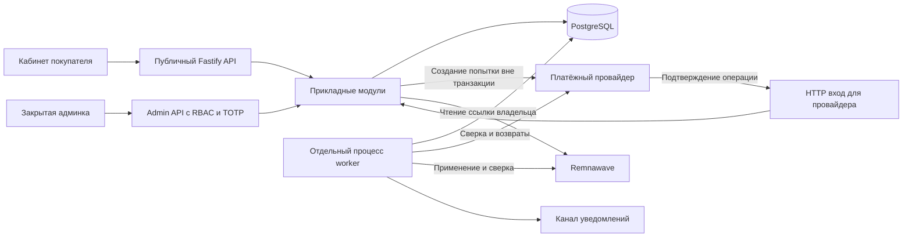

# VPNShop · Целевая архитектура коммерческого ядра

**Статус — проект фазы 2.** Исходная система проверена на `main@e036d19`, результаты независимого аудита — в `5cec359`. Названия команд, маршрутов и моделей ниже задают контракты будущей реализации. Первый релиз охватывает покупку фиксированного срока, продление одного VPN-доступа на аккаунт, выдачу через Remnawave и работу оператора. Эквайер и коммерческие условия подлежат выбору владельцем. [Аудит](audit.md) · [Дорожная карта и критерии готовности ядра](roadmap.md)

**Главное обязательство магазина.** Для каждого полученного платежа оператор может установить источник денег, заказ, начисленное право и последнее подтверждённое состояние доступа. Успешный возврат браузера со страницы оплаты, завершение задачи и успешное VPN-подключение — три разных события. [Денежные операции](payments.md) · [Подписки и выдача](subscriptions.md)

## Топология

Сохраняем TypeScript и монорепозиторий для общих публичных DTO и согласованных релизов, Fastify для HTTP, Prisma для моделей и транзакций, PostgreSQL для ограничений, блокировок и устойчивой очереди. Параметризованный SQL оправдан для конкурентного захвата задач и индексов, которых не выражает используемая версия Prisma. Worker получает отдельную точку входа и управляемый жизненный цикл в том же релизе. Масштабирование API тогда не изменит число исполнителей. Оснований добавлять отдельный брокер или базы на модуль по результатам аудита нет. [ADR 0001](adr/0001-modular-monolith.md)

## Владение данными и разрешённые зависимости

В таблице указаны **исходящие** вызовы модулей. Чужие таблицы изменяются только через команды владельца. Один прикладной сценарий может передать общий контекст транзакции нескольким командам. Для чтения Support и кабинета разрешены именованные read-only проекции. Сырые записи Prisma, ключи и клиенты провайдеров остаются внутри backend.

| Модуль | Чем владеет | Разрешённые вызовы и интерфейсы |
|---|---|---|
| Identity | Учётные данные, внешние идентификаторы, обычные и административные сессии | Возвращает principal с ID, типом сессии и правами. Другие модули используют ID. Отзыв привилегированных сессий и незавершённой привязки входит в контракт восстановления. |
| Catalog | Код, описание, доступность продукта, состав возможностей | Публикует описание тарифа и правила совместимости ограничений. Историю заказа не редактирует. |
| Pricing | Версии предложения, срок, валюта, сумма, ограничения, окно продажи | Читает Catalog. Публикует новую неизменяемую версию; предоставляет Orders команду получения действующих условий под транзакционной защитой. |
| Orders | Владелец заказа, снимок, окно оплаты, существование единственного зачтённого платежа | Читает Pricing и ID principal. Команды createOrder, allocateCapture и expireOrder. Передача одного заказа на исполнение определяется уникальной аллокацией. |
| Payments | Merchant account, попытка, финансовые события, движения, возвраты, сверка | Адаптеры изолируют сеть. Передаёт проверенный финансовый факт прикладному сценарию. Никаких вызовов Remnawave. |
| Subscriptions | Подтверждённое право, периоды, корректировки, блокировки и версии желаемого назначения | Принимает снимок и подтверждённую аллокацию, команды grant, adjust, block, unblock. Выдаёт проекцию для конкретного момента и следующее время изменения. |
| Fulfillment | Задачи, аренды, номера попыток, наблюдения, очередь повторной сверки | Читает текущее назначение Subscriptions. Вызывает Remnawave integration. Принимает команды ensureSync и reconcile. Завершение не меняет финансовую историю. |
| Remnawave integration | Контракт панели, сопоставление внешних ID, нормализация ошибок | Операции readAccount, applyDesired, readLink. Секреты доступны только backend. Ограничения адаптера подтверждаются контрактными и стендовыми тестами. |
| Administration | HTTP-точка входа для управляющих команд | Проверяет Identity и право на конкретное действие. Вызывает команды Catalog, Pricing, Payments, Subscriptions, Fulfillment. Тариф, ручная компенсация и requeue отражаются в Audit. |
| Audit | Неизменяемая запись «кто, что, когда, почему», ID корреляции и результата | append в той же транзакции, что и изменение. Для внешней операции отдельные записи о намерении и подтверждении. Доступ на чтение ограничен ролью. |
| Notifications | Задание доставки, шаблон, адресат, попытки, факт доставки | Читает outbox после commit; дедупликация по событию, каналу и адресату. Сбой доставки не отменяет оплату или начисление. |
| Support | Операторская проекция и история обращения с причиной расхождения | Читает разрешённые представления Orders, Payments, Subscriptions, Fulfillment. SUPPORT по умолчанию имеет чтение. Управляющие действия идут через Administration с причинами и полномочиями. |

Координатор подтверждения платежа находится на прикладном уровне и последовательно вызывает Payments, Orders, Subscriptions, Fulfillment, Audit и outbox. Модули не вызывают координатор обратно. Обратные зависимости запрещаются проверкой импортов по границам пакета/директорий при реализации. Shared содержит версионированные DTO, коды ошибок и схемы ввода. Правила признания денег и расчёта срока имеют единственную серверную реализацию.

## Тариф, предложение и заказ

| Вариант стартового каталога | Единица продажи | Что задаёт версия |
|---|---|---|
| 1 месяц | Одно продление на 1 календарный месяц UTC | Цена в выбранной валюте, устройства, ограничения и политика срока |
| 3 месяца | Одно продление на 3 календарных месяца UTC | Самостоятельная цена и версия. Скидка определяется публикацией |
| 6 месяцев | Одно продление на 6 календарных месяцев UTC | Самостоятельная цена и версия |

Срок — положительный параметр предложения. Новый срок, валюта, уровень доступа или группа серверов добавляются публикацией совместимой версии. Для MVP разрешены только ограничения, которые адаптер панели умеет применить и прочитать обратно. При публикации проверяются единицы, диапазоны и комбинации, включая лимит устройств, трафик, стратегию сброса и профиль доступа/squads. Пропущенное поле и «без лимита» имеют разные явные значения.

1. ADMIN публикует OfferVersion с ID и возрастающим номером внутри предложения, интервалом продажи UTC и версией политики. Опубликованные коммерческие поля неизменяемы. Снятие с продажи закрывает новые заказы. Редактирование цены создаёт новую версию.
2. Каталог возвращает доступные варианты и ID версии. Клиент отправляет ID версии и Idempotency-Key. Полученные из клиента сумма, валюта или лимиты отвергаются. В одной транзакции Orders проверяет владельца ключа и хеш запроса, действительность цены и тарифа на время БД, записывает снимок и ответ. Публикация/снятие с продажи и проверка активной версии сериализуются по строке предложения. Устаревшая версия даёт конфликт с предложением обновить каталог.
3. Снимок содержит ID/версию предложения и тарифа, отображаемое название, сумму в минимальных единицах и валюту, срок в месяцах, устройства, версионированные дополнительные ограничения, версию правил расчёта/возврата, время фиксации и expiresAt. Снимок нельзя переопределить при оплате, продлении и последующих изменениях каталога.
4. Сервер вычисляет expiresAt как минимум конца доступного окна и времени создания плюс настроенный TTL. Число минут и возможность выключить уже выданные предложения — решения владельца. Ключ уникален по пользователю и операции. Повтор возвращает первоначальный заказ, включая истёкший; изменённое тело с тем же ключом даёт 409. Для новой покупки нужен новый ключ. При повторе после сетевого таймаута lookup ключа предшествует повторной проверке цены.

**Переходы заказа.** OPEN → ALLOCATED при первом зачтённом захвате средств, OPEN → EXPIRED по часам БД, OPEN → CANCELED по допустимой отмене до зачёта. EXPIRED → ALLOCATED разрешён только для проверенной своевременной оплаты с запоздалой доставкой события либо явно одобренного урегулирования. CANCELED с поступившими деньгами открывает разбор. ALLOCATED остаётся историческим фактом после возврата. Состояния платежа, возврата и доступа выводятся в карточке заказа отдельно. Повторная доставка предыдущего статуса не откатывает переход.

## Точки входа и транзакции

| Интерфейс | Граница доступа и результат |
|---|---|
| GET /api/plans, POST /api/orders, GET /api/orders/:id | Цены публичны, заказ привязан к авторизованному владельцу на каждом чтении/изменении. Ответ содержит только поля кабинета. |
| POST /api/orders/:id/payments | Владелец и открытый заказ. Проверяются ключ, выбранный канал и неизменность снимка. Возвращает ID попытки и разрешённое следующее действие. |
| POST /webhooks/:provider/:account | Отдельная точка вне браузерной cookie-аутентификации. Маршрут выбирает конфигурацию аккаунта, доверие устанавливает адаптер. [Протокол обработки](payments.md) |
| GET /api/me/subscription и GET /api/me/subscription/link | Актуальная сессия и собственный доступ. Статус отдаётся с временем наблюдения. Для ссылки дополнительно проверяются блокировки, срок и профиль панели, ответ no-store. |
| Закрытый Admin API | Поиск по заказу, merchant reference, транзакции или ID клиента. ADMIN публикует цену, открывает возврат, оформляет корректировку и requeue. SUPPORT видит причину, суммы, время и статус, без токенов, ссылок и полных payload. |
| Внутренние события | Идентификатор события, тип, версия схемы, агрегат и версия, correlationId, время. Outbox пишется с бизнес-изменением. Повторная доставка ожидаема; каждый потребитель фиксирует свой уникальный факт обработки. |

**Общий порядок блокировок** для всех пишущих сценариев — строка заказа, затем связанные попытки и исходные финансовые операции (по стабильному ID), затем подписка пользователя, затем задание. Заказ с неизвестным владельцем события сначала сопоставляется по доверенному merchant reference. Если целевой заказ ещё не установлен, событие сохраняется в inbox и ждёт разбора. Административная операция только над подпиской берёт её строку и не пытается затем захватить заказ. Рабочий процесс берёт lease отдельной короткой транзакцией, освобождает SQL-блокировки до HTTP и при фиксации использует общий порядок. Вставка отсутствующего агрегата защищена уникальным ключом и повторным чтением после конфликта. Deadlock/serialization failure требует ограниченного повтора всей локальной команды с тем же ID. Сеть никогда не держит транзакцию БД открытой.

| Операция | Что коммитится вместе | Граница сбоя, восстановление и проверка |
|---|---|---|
| Публикация и заказ | Версия с аудитом; отдельно заказ со снимком и ключом | Одновременное снятие цены и оформление дают либо полный действовавший снимок, либо конфликт. Два запроса с одним ключом возвращают один ID. |
| Признание оплаты | Финансовая операция, аллокация, один grant, обновление назначения, задача, processed inbox и outbox | Откат оставляет событие доступным повтору. Commit до HTTP-ответа безопасен при повторной доставке. Проверить обе точки остановки. |
| Возврат и корректировка | Намерение с резервом возвратной суммы фиксируется до HTTP; подтверждённое движение, освобождение резерва, решение по праву и audit — в следующем commit | Потеря ответа ведёт в сверку; новая попытка требует известного исхода. Тест — возврат между отправкой и подтверждением выдачи. |
| Блокировка и восстановление | Причина, actor, право, назначение новой версии, задача, audit | Кабинет прекращает выдавать ссылку с первого commit. Ранее импортированный доступ зависит от применения состояния панелью. Проверить отказ панели и время фактической блокировки. |
| Отправка уведомления | Устойчивое намерение доставки с бизнес-событием, результат доставки отдельно | При таймауте использовать идентификатор сообщения, если канал поддерживает. Иначе возможен повтор письма. Проверить сбой после отправки и отсутствие повторного начисления. |
| Разбор поддержкой | Чтение по роли; ручное решение — команда с ключом, причиной и аудитом | Повтор клика не создаёт вторую компенсацию. Проверить отказ SUPPORT, неизменность данных при ошибке аудита и видимость результата оператору. |

## Изменения данных и совместимость

Исходная Prisma schema содержит изменяемые Plan и PlanPrice, снимок четырёх полей в Order, Payment с необязательным externalId, WebhookEvent, User.remnawaveUserId и FulfillmentJob с уникальным orderId и targetExpireAt. Истории миграций в проверенном Git нет. Новая схема должна сохранять эти источники до сверки. [Исходные модели](../apps/api/prisma/schema.prisma#L219)

| Текущая модель | Предлагаемое дополнение и ключевые индексы |
|---|---|
| Plan / PlanPrice | OfferVersion: уникальный (offerId, version), период публикации, снимок политики, сумма и валюта. Индекс каталога по продукту и окну действия. В БД исключить неоднозначную активную версию одного варианта. |
| Order | orderSnapshot, offerVersionId, state, policyVersion, ключ и fingerprint. UNIQUE(userId, operation, idempotencyKey). Индексы владельца по createdAt и открытых заказов по expiresAt. Запрет изменения снимка после создания на уровне записывающей роли/БД. |
| Payment / WebhookEvent | PaymentAttempt, PaymentTransaction, ProviderEvent, OrderAllocation, Refund, ReconciliationCase с составными ключами аккаунта и среды. Денежные значения целочисленные с проверками диапазона; агрегаты используют точную арифметику. [Ключи и индексы](payments.md) |
| User / продление | Subscription UNIQUE(userId) в первой версии, PeriodGrant с уникальным источником, Adjustment, ServiceHold, DesiredAssignment и PanelObservation. Индексы по подписке и границам времени; уникальность (subscriptionId, revision). Наблюдения по времени и привязке панели. |
| FulfillmentJob | SyncJob с целью (subscriptionId, revision), leaseOwner, leaseToken, leaseUntil и nextRunAt. Причина заказа хранится как ссылка. Повторная сверка **той же версии** переоткрывает её задачу с новым token. Индексы частичные по готовым, истёкшим арендам и сроку следующей проверки. |
| AuditLog | Добавить commandId, correlationId, ссылки на финансовую операцию, actor и причину. Outbox, delivery и обработанные события уникальны по ключам потребителя. Ограничить права редактирования истории и определить срок хранения персональных данных. |

### Миграция и возврат версии

1. **Инвентаризация и репетиция.** Снять резервную копию и восстановить на отдельном экземпляре. Сопоставить реальную схему с Git, типы и валюты, дубликаты externalId, доли NULL, количество заказов по статусам, суммы по валюте/провайдеру, открытые задачи, связи User с панелью и ручные блокировки. Проверить доступ к ключам TOTP. Снять исходные показатели и согласовать окна остановки. Baseline Prisma вводится только после подтверждения фактической схемы.
2. **Расширение.** Добавить совместимые таблицы/nullable-ссылки и индексы без изменения старых читателей. Индексы на больших таблицах строить с контролем блокировок, ограничения валидировать после backfill. Старая и новая версии должны запускаться на расширенной схеме. Проверить миграцию чистой БД и копии существующей.
3. **Backfill с контрольной точкой.** Идемпотентные партии по первичному ключу с source ID и таблицей соответствий. Историческим заказам переносить фактические четыре поля; неизвестную версию, имя и дополнительные условия маркировать legacy/unknown. Текущий PlanPrice не доказывает прошлую цену. Исторический Payment переносить как попытку; PAID/REFUNDED без доказательства конкретного движения пометить для сверки, не создавать фиктивные capture/refund. Дедуплицированные записи о старых событиях сохранить.
4. **Перенос прав и незавершённой работы.** Подтверждённые привязки сверить по внешнему ID и username, статусу, лимитам и сроку. Там, где истории недостаточно, создать явно помеченный opening balance права на момент среза, с происхождением и независимой проверкой оператора. Старые FULFILLED связываются как уже учтённые в исходном остатке. PAID с сохранённым targetExpireAt сверяется чтением панели до любого повторного применения; неоднозначность, FAILED, DISABLED или конфликт ID идут в список разбора. Сверить также пользователей без текущих заказов и операции после начала backfill.
5. **Переключение.** Теневое чтение и сравнение по пользователям и денежным итогам. Затем кратко остановить новые коммерческие записи/старого воркера, дождаться исхода отправленных запросов, буферизовать входящие события в durable inbox либо получить гарантированный повтор провайдера. Догнать изменения до зафиксированной контрольной точки. Переключить единственного писателя, начать с ограниченной группы. Критерий — ноль необъяснённых денежных расхождений, двойных grant и потерянных задач; спорные права изолированы и назначены оператору.
6. **Rollback.** До первого нового внешнего эффекта можно вернуть старые чтения/worker за флагом. После новых захватов, возвратов или изменений панели деньги и панель назад по снимку БД не откатываются. При аварии остановить писателя и выдачу, продолжать приём inbox, сверить журнал от контрольной точки. Старый писатель допустим только для данных, доказанно представимых старой схемой и перенесённых обратно; иначе режим чтения и исправление вперёд. На копии отрепетировать оба сценария, включая callback во время переключения. Удаление legacy-полей — отдельный релиз после окна наблюдения, резервной копии и проверки восстановления.

**Контроль переноса по старым статусам.** PENDING с открытой попыткой сохраняет merchant reference, если её происхождение доказано; при неизвестном исходе повторное выставление счёта блокируется до сверки. EXPIRED/CANCELED сами по себе не доказывают отсутствие денег — сравнить со списком поступлений за окно. REFUNDED без суммы, даты или исходного захвата остаётся legacy-фактом с делом на сверку. Старую RUNNING нельзя передать новому worker только по признаку истёкшей аренды: остановить прежнего писателя и прочитать состояние панели. Для старых PAID/DONE и PAID без задачи сравнить targetExpireAt, действующий профиль и историю, зафиксировать основание решения об учёте. Повтор backfill на том же снимке должен дать ноль дополнительных денег, grant и внешних команд. Стендовый rollback проверяет в том числе данные одного старого и одного нового покупателя до и после переключения.

## Эволюция и решения владельца

Сначала восстановить генерацию Prisma и DB-тесты, закрыть риски отзыва административных сессий и подготовки тестовой БД из аудита. Затем провести одну стендовую покупку с неизменяемым снимком до реального подключения, после неё — двойные платежи, продления, возвраты и устаревшие попытки. Параллелизм worker увеличивать по измерениям задержек и после испытаний восстановления. Рабочая админка, наблюдаемость и восстановление из копии входят в приёмку ядра до этапа дизайна. Исходные тестовые результаты фазой 2 не пересматривались. [Порядок приёмки](roadmap.md)

Владельцу предстоит подтвердить рынок, разрешённые каналы и валюты; цены и ограничения вариантов 1/3/6 месяцев; TTL заказа и политику поздних платежей; один доступ на аккаунт; начало оплаченного времени, смену лимита и компенсацию простоя; полномочия поддержки, возвраты и chargeback; приоритет ручных блокировок панели, максимально допустимую задержку блокировки/выдачи, сроки хранения, RPO и RTO. До утверждения численные SLA, политика денег и поставщик остаются открытыми. [Варианты платёжных каналов](payments.md) · [Примеры расчёта подписки](subscriptions.md) · [ADR учёта](adr/0002-commerce-records.md) · [ADR синхронизации](adr/0003-panel-convergence.md)
