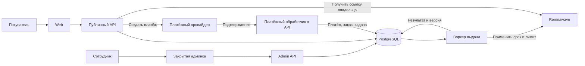

# Vpnshop. Аудит и архитектура первой продажи

Проверенная версия — `c8d570e` из `vpn-shop4.zip`. Это проект решения для обсуждения и реализации. Целевой результат первой поставки — человек выбирает тариф, оплачивает его, получает ссылку Remnawave в своём кабинете и может продлить доступ без потери оплаченного времени.

## Что уже работает по коду и тестам

В репозитории есть публичная авторизация по email и OIDC, отдельный сервер администрирования с TOTP, ролями и журналом действий, редактор тарифов на уровне admin API, модели заказов и платёжных попыток в PostgreSQL. У заказа есть снимок цены, валюты, срока и лимита устройств. Это подходящая основа коммерческого учёта.

Клиент панели сверяется в тестах с `@remnawave/backend-contract@3.4.17`. Воркер вычисляет абсолютную дату окончания, сохраняет её перед внешней записью и повторяет операцию с тем же сроком. При продлении берётся более поздняя из двух дат — текущее время или окончание действующего доступа. Месяцы календарные, в UTC. Эти свойства стоит сохранить. [Контракт](../apps/api/src/modules/remnawave/remnawave.contract.test.ts) · [Расчёт срока](../apps/api/src/modules/remnawave/remnawave.dates.ts) · [Выдача](../apps/api/src/modules/fulfillment/fulfillment.processor.ts)

На проверенной версии `pnpm install --frozen-lockfile` и `pnpm build` завершились успешно. `pnpm test` выполнил 117 тестов — 98 API, 12 web и 7 shared. Генерация Prisma получила HTTP 403 на контрольной сумме с `binaries.prisma.sh`, в том числе при повторной проверке доступа. Общая проверка типов завершилась ошибкой при отсутствии сгенерированных типов. Интеграционные тесты с PostgreSQL и проверка на живой панели остаются открытыми. Сборщик API использует tsup, проверка типов запускается отдельно. [Команды API](../apps/api/package.json) · [Конфигурация интеграционных тестов](../apps/api/vitest.integration.config.ts)

## Приоритеты по результатам аудита

| Когда устранить | Наблюдение в текущем коде | Последствие и изменение |
|---|---|---|
| До первого платежа | Публичный Fastify регистрирует health, auth и OAuth. У `enqueueFulfillment` есть тестовые вызовы, производственного обработчика оплаты нет. [Маршруты](../apps/api/src/app.ts) · [Очередь](../apps/api/src/modules/fulfillment/fulfillment.queue.ts) | Покупатель не может пройти от тарифа до оплаты. Добавить каталог, создание заказа, одну платёжную интеграцию и транзакционное подтверждение. |
| До первой продажи | Клиент панели разбирает `subscriptionUrl`, а воркер сохраняет идентификатор пользователя панели. В кабинете отображаются email и способы входа. [Ответ панели](../apps/api/src/modules/remnawave/remnawave.schemas.ts) · [Кабинет](../apps/web/src/pages/AccountPage.tsx) | Даже после успешной выдачи покупателю негде получить ссылку. Нужны статус доступа и отдельная авторизованная операция получения ссылки. |
| До приёма платного трафика | `claimNextJob` сначала выбирает первые 25 задач, затем проверяет предшественников. Если вся выборка ждёт более раннюю незавершённую задачу, функция возвращает `null`. [Выборка](../apps/api/src/modules/fulfillment/fulfillment.queue.ts) · [Размер окна](../apps/api/src/modules/fulfillment/fulfillment.constants.ts) | Готовые задачи других пользователей за этим окном остаются без обработки. Перенести условие отсутствия предшественника в запрос до ограничения выборки. Закрепить тестом с 25 ожидающими и независимым заказом. |
| До автоматизации возвратов и нескольких воркеров | Статус заказа читается при захвате. После ответа панели `completeJob` помечает задачу завершённой и игнорирует число заказов, перешедших из `PAID`. Обновления задачи после захвата проверяют только её ID. [Фиксация результата](../apps/api/src/modules/fulfillment/fulfillment.queue.ts) | При возврате во время выдачи либо возобновлении старой попытки возможны противоречивые состояния. Ввести версию назначения и идентификатор попытки, проверять результат условного обновления. После внешнего вызова сверять применённую версию с актуальной, назначать корректирующую задачу при расхождении. До этого использовать один воркер. |
| До обещания «доступ активен» | Для вручную отключённого пользователя панель сохраняет `DISABLED`, а обработчик завершает заказ с примечанием. [Обработчик](../apps/api/src/modules/fulfillment/fulfillment.processor.ts) | Деньги учтены, срок назначен, подключение может быть недоступно. Отдельно показывать состояние оплаты и состояние доступа, отправлять такие случаи оператору. Сохранять ручную блокировку. |
| До первого релиза | В Git есть схема Prisma, каталога миграций нет. Команда подготовки тестовой БД использует принудительный сброс, а проверка имени БД находится в коде последующей очистки тестов. [Скрипт](../apps/api/package.json) · [Очистка](../apps/api/src/test/db.ts) | Завести версионированные миграции, проверять обновление существующей БД на копии. Интеграционным тестам выделить одноразовую БД и отдельные права, проверять назначение до любой команды сброса. |
| До передачи поддержке | Admin API обслуживает тарифы, задачи и аудит на отдельном порту. Admin UI показывает только health, а его Vite-прокси ведёт на публичный API. [Интерфейс](../apps/admin/src/App.tsx) · [Прокси](../apps/admin/vite.config.ts) · [Admin API](../apps/api/src/modules/admin/admin-app.ts) | Текущий зелёный индикатор не подтверждает работу админки. Подключить интерфейс к закрытому admin API, реализовать вход с TOTP, поиск заказа и действия по роли. |
| До публичного развёртывания | В публичном API установлен `trustProxy: true`. Доверие к заголовкам зависит от топологии развёртывания, а `/api/ready` проверяет только доступность БД. [Fastify](../apps/api/src/app.ts) · [Readiness](../apps/api/src/modules/health/health.routes.ts) | Ограничить доверие известным прокси и закрыть прямой доступ к backend. Раздельно наблюдать доступность API, возраст оплаченных заказов без выдачи и состояние панели. |

## Целевая архитектура

Сохранить монорепозиторий, TypeScript, Fastify, Prisma и PostgreSQL. Для объёма первой продажи достаточно модульного монолита с отдельно запускаемым процессом выдачи. Заказ, признание оплаты и постановка задачи тогда используют транзакции одной БД. Перезапуск публичного API не прерывает работу воркера. Admin API доступен через закрытую точку входа и использует существующие права и аудит.

| Модуль | Ответственность и граница записи |
|---|---|
| Каталог и заказы | Каталог публикует только активные предложения. При оформлении клиент передаёт ID цены. Сервер проверяет её и сохраняет снимок, срок оплаты и ключ повторного запроса. Для пары «пользователь + ключ» действует уникальность. Изменение тарифа сохраняет условия уже оформленного заказа. |
| Платежи | Один адаптер на провайдера. Создание платёжной попытки, привязка внешнего ID, проверка подлинности уведомления согласно договору провайдера, запрос статуса и сверка спорных платежей. Внешнюю ссылку на оплату можно вернуть только после сохранения идентификатора попытки. |
| Подписки | В PostgreSQL хранить историю оплаченных периодов с уникальным `orderId` и текущее назначение пользователя — желаемый срок, лимит и версию. Отдельно хранить последний подтверждённый статус панели, срок, идентификатор, версию и время сверки. Финансовая история объясняет, за что заплатил клиент, наблюдаемое состояние панели — чем он сейчас может пользоваться. |
| Выдача и Remnawave | Один модуль владеет созданием и обновлением пользователя панели. Сохранять детерминированный username, абсолютные значения и порядок по пользователю. Вызов панели выполняется вне транзакции БД. После сбоя на границе HTTP и commit повторить чтение и применить актуальное назначение. |
| Кабинет и поддержка | Владелец видит заказ, платёж и доступ отдельно. Сотрудник видит те же идентификаторы и причину задержки. Действия повторной выдачи и урегулирования записываются в существующий аудит с указанием сотрудника и причины. |

### Первая покупка и продление

1. `GET /api/plans` возвращает активные цены. `POST /api/orders` принимает `priceId` и ключ идемпотентности. Повтор с теми же данными возвращает тот же заказ. Тот же ключ с другими данными даёт конфликт.
2. `POST /api/orders/:id/payments` проверяет владельца, статус и срок заказа. Сначала сохраняет локальную попытку. Для создания счёта у провайдера использует стабильный ключ или поиск по merchant reference согласно его контракту. Таймаут создания переводит попытку в сверку до следующего списания.
3. Обработчик уведомления проверяет подлинность сообщения и сопоставляет продавца, внешний платёж, заказ, сумму и валюту. Одна транзакция записывает уникальное событие, фиксирует полученные деньги, условно переводит заказ в `PAID` и вызывает существующий `enqueueFulfillment(tx, orderId)`. Успешный ответ провайдеру — после commit. Возврат браузера со страницы оплаты лишь открывает статус заказа.
4. Воркер резервирует оплаченный период один раз под блокировкой подписки. Для нового или истёкшего доступа предлагается отсчёт от начала фактической выдачи, для действующего — от его конца. Если простой съел существенную часть уже запланированного периода, оформить явную компенсацию с записью причины. Каждый повтор одной выдачи применяет одну и ту же дату. Существующих клиентов при переходе на локальный учёт сначала сверить с панелью и сохранить исходный остаток.
5. После подтверждения панели воркер фиксирует применённую версию, срок и состояние. `GET /api/orders/:id` и `GET /api/me/subscription` позволяют показать «ожидает оплаты», «оплачен, подключаем», «активен», «требует поддержки» и дату последней проверки. Для покупателя со старым активным периодом задержка продления не скрывает действующий доступ.
6. `GET /api/me/subscription/link` проверяет владельца и доступность подписки, а затем читает готовый `subscriptionUrl` у панели. Ответ — с `Cache-Control: no-store`. Ссылку исключить из аналитики, журналов и обычных списков заказов. При недоступности панели кабинет показывает сохранённый статус и время его проверки, а получение ссылки предлагает повторить. Экран подключения объясняет, как импортировать ссылку в поддерживаемый VPN-клиент.

### Исключения, важные для денег и доступа

| Событие | Ожидаемое действие |
|---|---|
| Один платёж подтверждён несколько раз, в том числе разными событиями | Идемпотентность по событию дополняется условным переходом заказа и одним оплаченным периодом на заказ. Сумма и срок начисляются один раз. |
| Два разных платежа успешно прошли по одному заказу | Сохранить обе денежные операции. Вторую пометить для урегулирования или возврата, не создавать вторую выдачу. |
| Подтверждение пришло после истечения заказа или потерялось | Сверить статус и время фактической оплаты у провайдера. Платёж, совершённый вовремя, принять по снимку заказа. Для фактически поздней оплаты — учесть деньги и направить на урегулирование по утверждённому правилу. |
| Вернули деньги после выдачи или после следующего продления | Хранить возврат отдельной операцией с привязкой к исходной оплате. Пересчитать оставшееся право по истории периодов, обработать последующие оплаченные покупки, записать корректировку и запланировать сверку. Частичный возврат требует явного правила продукта. |
| Панель недоступна или вернула ручную блокировку | Оплата остаётся подтверждённой. Временные сбои идут в повтор, ручная блокировка — оператору. Сверка сравнивает желаемый и фактический доступ, расхождения видны в поддержке. |

## Рабочие места покупателя и сотрудника

Кабинет и закрытая админка входят в ядро магазина. Для приёмки используются обычные формы, таблицы и статусы, доступные из браузера. В админке сотрудник входит с TOTP, находит заказ по номеру или внешнему ID платежа и видит цепочку «попытки оплаты → оплаченный период → попытки выдачи → состояние в панели». Эта карточка нужна и для случая, когда у клиента несколько последовательных продлений.

SUPPORT читает состояние и причину задержки. ADMIN управляет тарифами и ценами, повторяет завершившуюся ошибкой выдачу после устранения причины и оформляет доступные операции урегулирования. Сумму, валюту, автора, причину и результат денежного действия сохраняет сервер. Изменяющие операции проверяют полномочия в admin API. Разделение интерфейсов, закрытый адрес админки и раздельные сессии сохраняются при подключении фронтенда.

Порядок поставки, текущий статус работ и условия перехода к дизайну ведутся в [дорожной карте](roadmap.md). Таблица аудита выше описывает исходный коммит.

Открытые продуктовые решения — первый провайдер и валюта, момент применения нового лимита устройств при смене тарифа, правила поздней оплаты и возврата. Для проектирования принят один доступ Remnawave на аккаунт и покупка фиксированного срока с ручным продлением. Предлагаемый первый канал — Platega/СБП в RUB, если есть подключённый мерчант и тестовый доступ. До реализации адаптера сверить доступные операции, аутентификацию уведомлений, идемпотентность и сверку платежей по документации выбранного провайдера.
