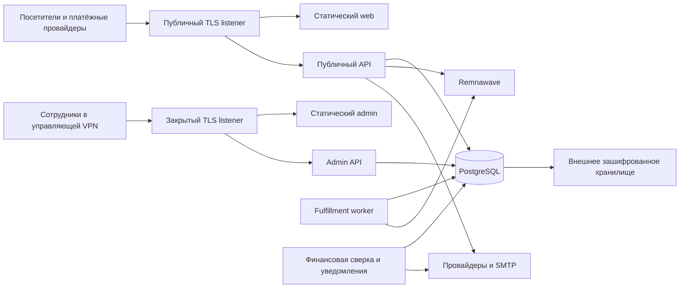

# Развёртывание VPNShop на одном VPS

Phase 5. Два входа Fastify, два статических frontend, отдельные фоновые процессы и PostgreSQL в одном Compose-проекте. [Архитектура](architecture.md) · [Админка](admin.md) · [Безопасность](security.md) · [Эксплуатация](operations.md)

## Реализация OPS-01

| Артефакт | Процессы и назначение |
|---|---|
| `application` | `dist/server.js` (public), `dist/admin.js` (staff), `dist/worker.js` (выдача), `dist/billing.js` (финансовый процесс в закрытом режиме), `dist/notifications.js` (почтовый outbox), `dist/exporter.js` (агрегаты). Один образ, отдельные контейнеры. |
| `migrator` | `mzt-migrate` применяет Prisma migrations, проверяет статус и транзакционно назначает grants. Точка запуска выше runtime прав. |
| `web`, `admin`, `edge` | Два статических пакета и образ Nginx для двух отдельных TLS listeners. |
| `db`, `backup` | PostgreSQL 17 с pgBackRest и отдельный клиент логической копии. |

[Образы](../Dockerfile) · [Образы БД](../ops/db/Dockerfile) · [Compose](../ops/compose.yml) · [CI](testing.md#инфраструктурные-проверки-ops)

## Топология и сетевые соединения

Два контейнера Nginx с независимыми сетями и TLS ключами раздают статические пакеты того же релиза. Один VPS и один PostgreSQL достаточны для пилота. Для сотрудников использовать существующую управляющую сеть либо WireGuard на хосте. Каждому сотруднику отдельный ключ с возможностью отзыва. Клиентская VPN-подписка изолирована от управляющей сети.

| Откуда → куда | Порты и интерфейсы | Условия |
|---|---|---|
| Интернет → edge | TCP 443 на публичном адресе. Публикуется только настроенный TLS-порт. Выдача сертификатов выполняется отдельно. | Только точный WEB_ORIGIN. `/api/*` ведёт в public API, `/webhooks/*` — к зарегистрированным backend адаптерам. SPA fallback только для web-страниц. Webhook проверяет поставщика и не переадресуется на login. |
| Сотрудник → host и admin edge | Управляющая VPN, например UDP 51820 для WireGuard. SSH TCP 22 и admin HTTPS TCP 443 только на управляющем интерфейсе. | Admin hostname и приватный DNS. Проверить интерфейс входящего соединения и допустимые peer. Публичный listener отклоняет admin Host/SNI. SSH по ключам, доступ через консоль хостинга для восстановления. VPN не заменяет staff login/TOTP. |
| Edge → public API / admin API | TCP 3000 в `public-api-edge` и TCP 3001 в `admin-api-edge`. | На интерфейсе контейнера возможен bind 0.0.0.0. Host publish отсутствует. Прокси не подключается к сетям PostgreSQL. Public API не имеет маршрута в admin_net или сеть PostgreSQL админки. |
| Runtime, migrator, backup → PostgreSQL | TCP 5432 по отдельным `public-db`, `admin-db`, `tasks-db`, `finance-db`, `notifications-db`, `monitoring-db`, `backup-db` и `migration-db`. В каждом сегменте PostgreSQL и потребитель соответствующей роли. | Нет host publish. Подключения требуют SCRAM. Доступ к данным определяется grants и RLS. Для внешнего подключения или маршрутизации за пределы хоста отдельно согласовать `pg_hba` и firewall. |
| Runtime → внешние зависимости | TCP 443 к утверждённым origin OAuth, панели и платёжных API. SMTP 465/587 с TLS при необходимости. DNS к доверенному resolver. | Отдельные egress сети или ACL по роли без объединения public и admin. Фиксированные назначения, границы таймаута и параллелизма. Public API читает профиль для выдачи ссылки и создаёт платёжную попытку по контракту. Admin API исходит из локальных наблюдений, команды провайдерам идут через backend. |
| Backup, edge, alert sender → внешние сервисы | TCP 443 для архива, ACME, мониторинга и уведомлений. | Отдельные credentials по назначению. Метрики, служебные probes и exporter доступны только в управляющей сети или локальному сборщику. [Секреты](security.md#конфигурация-и-секреты) |

Проверять Docker port publishing отдельно от хостового firewall. IPv6 подключать после проверки эквивалентных ACL. Снаружи и из разрешённой сети проверять API ports, закрытый HTTPS, SSH, PostgreSQL и служебные пути. Proxy пересобирает forwarding заголовки. [Trust proxy](security.md#границы-доверия-и-угрозы)

TLS завершается на edge. Для публичного origin — ACME. Для закрытого — сертификат через DNS-01 с доступом только к challenge-записи или утверждённая внутренняя PKI. Сертификаты и ключи монтируются только edge read-only. Проверять SAN, цепочку, обновление и reload без остановки, срок действия. TLS 1.2/1.3, HSTS на проверенных HTTPS-доменах. Соединения к внешним API и хранилищу проверяют TLS. Proxy ↔ API ограничен контейнерными сетями одного VPS.

## Процессы, запуск и ёмкость

| Процесс | Запуск, готовность и остановка | Проектные ограничения |
|---|---|---|
| Edge и статика | Синтаксис, сертификаты и отдельные vhosts до открытия listeners. Статика доступна независимо от БД. Недоступный upstream получает 503. | 0.25 vCPU / 256 MiB |
| PostgreSQL 17 | Постоянный том. `pg_isready` проверяет процесс, чтение под ролью приложения — доступ к схеме. Остановить после процессов runtime с запасом на checkpoint. | 1.5 vCPU / 3 GiB, начально до 60 соединений |
| Public API / Admin API | Валидация config и диапазона версий схемы. При SIGTERM закрыть readiness, прекратить приём, закончить ограниченные по времени операции и закрыть пул. | 0.75 vCPU / 768 MiB и 0.5 vCPU / 512 MiB, пулы до 10 и 5 |
| Fulfillment worker | Отдельный процесс, панельные записи после допуска сборки. При SIGTERM прекратить захват, завершить либо оставить попытку для verify-first. | 0.75 vCPU / 768 MiB, пул до 5, сначала один экземпляр |
| Финансовая сверка и уведомления | Процессы одного релиза с durable checkpoints/inbox/outbox. Запуск идемпотентный, активная работа сериализуется по мерчанту или расписанию. Панельная сверка выполняется Fulfillment. | 0.5 vCPU / 512 MiB, суммарный пул до 5 |
| Migrator и backup | Один deploy lock и одноразовый migrator. Backup host timer или одноразовая задача с отдельной ролью. | Ограничить I/O, резерв соединений для миграций, backup, диагностики и оператора |

Стартовый VPS для измерений — 4 vCPU, 8 GiB RAM и SSD от 80 GiB. Зарезервировать хосту и эксплуатации минимум 1.5 GiB. На стенде измерить peak RSS, CPU throttling, p95 и I/O под нагрузкой, рост WAL и место под ближайший backup. Скорректировать границы до пилота. [Пороги](operations.md#метрики-и-оповещения)

Порядок запуска: сети → DB → backup preflight для существующей базы → один migrator → API и proxy → smoke чтения → фоновые процессы в паузе → проверка интеграций → разрешение задач. Зависимости при старте дополняются bounded retry в runtime. Для постоянных сервисов `unless-stopped`, для migrator restart disabled. Docker сам не перезапускает unhealthy контейнер. Crash loop требует оператора. Compose проверяет readiness процесса. Независимый liveness нужен для диагностики при отказе БД. При дренировании или недоступной DB API отвечает 503 на операции, требующие готовности. Настроить edge на предсказуемый ответ при недоступном upstream.

Проектный stop grace — 30 с для API с общим deadline запроса до 20 с, 60 с для worker при ограниченной длительности активного HTTP и фиксации, 120 с PostgreSQL. Калибровать на стенде. Запускать Node напрямую с доставкой сигналов главному процессу, одним обработчиком shutdown и закрытием пула после обработки. При hard stop восстановление идёт по durable состоянию. [Работа воркера](operations.md#выдача-и-фоновые-процессы)

## Артефакты и обновление

* Multi-stage build с закреплённым digest и SHA исходника, одинаковый ABI для Prisma/Argon2 при сборке и запуске. Runtime Node без root, cap-drop по умолчанию, no-new-privileges, read-only rootfs и tmpfs по возможности. Docker socket, dev server и credentials в build context исключаются. Статика и SBOM воспроизводимы из registry.
* Отдельные постоянные тома для PGDATA, файлов TLS и временного backup/WAL spool. У журналов собственный лимит. Локальный том не заменяет внешнюю копию. Postgres закреплён по minor и digest, major upgrade требует отдельной репетиции.
* Деплой выполняется одним оператором или защищённым job с lock. Манифест хранит digests, версию схемы, имя окружения, конфигурационные ключи без значений и последний совместимый образ. Выкатка переключает статику атомарно, HTML имеет короткое кеширование, статические assets с hash допускают долгий кеш. API и worker обновляются по digest. На одном VPS возможна краткая недоступность во время замены. Платёжный ingress следует протоколу durable ACK из Phase 2. [Релиз и откат](operations.md#релиз-и-откат)

## PostgreSQL и миграции

1. **Чистая установка.** На новом томе создать БД и роли PostgreSQL. Владелец объектов и migrator отделены от runtime. Не давать runtime CREATE/DROP или роль владельца. Ограничить доступ по приложениям, финансовым таблицам и append-only Audit. Backup использует минимальные права выбранного инструмента, доступ мигратора временный. Создание схемы выполняет `pnpm --filter @vpn/api exec prisma migrate deploy` из совместимого артефакта.
2. **Подготовка существующей БД.** Снять инвентаризацию схемы, migration history, custom индексов и ограничений. При отсутствии истории подготовить baseline, применяемый к пустой БД. Маркировать его применённым на legacy через migrate resolve можно только после проверенного равенства каталога и истории. Расхождения сначала классифицировать. Хранить идентификаторы миграций и checksums.
3. **Репетиция.** Изолированная копия production с ограниченным доступом/retention, интеграции заблокированы или заменены sandbox. Выполнить миграции на чистой БД и копии, измерить длительность, блокировки, временный диск и планы запросов. Задать lock/statement timeout по замерам. Проверить и старый runtime с расширенной схемой, и новый runtime. Сравнить финансовые и сервисные контрольные итоги.
4. **Применение.** Проверить backup и непрерывный WAL, свободный диск, текущую историю, совместимость образа и отсутствие второй операции деплоя. Expand добавляет таблицы и nullable поля. Backfill выполняется малыми идемпотентными сериями с курсором и проверкой дубликатов. Для `CREATE INDEX CONCURRENTLY` выделить отдельный совместимый SQL шаг, проверить завершение и отсутствие invalid indexes. Необратимые удаления, обязательность и смена типа идут отдельным contract-релизом после окна отката. [Миграции Phase 2](architecture.md#миграция-и-возврат-версии)
5. **Целостность.** Проверить UNIQUE событий и денежных фактов, одну аллокацию и grant на заказ, уникальность привязки и версии назначения, ссылки между сущностями и индексы выборки готовых lease. Транзакционные границы и порядок блокировок из Phase 2 сохраняются. [Транзакции](architecture.md#точки-входа-и-транзакции) · [Деньги](payments.md#операционная-сверка-и-контрольные-равенства)
6. **Ошибка.** Прервать rollout и определить, что успело зафиксироваться, по журналу и каталогу БД. При добавочной проверенной схеме оставить старый совместимый runtime. Частично выполненный шаг исправить согласованной forward migration или решить статус конкретной миграции после сверки факта и данных. Production reset, force push схемы и восстановление старой копии поверх рабочей БД исключены. При несовместимости удерживать мутации по процедуре инцидента. [Откат](operations.md#релиз-и-откат)

### Принятие baseline FND-02

Baseline `20261121000000_baseline` соответствует datamodel из `43dd458`. Для чистой целевой БД выделить роль мигратора, проверить адрес, БД и пользователя, затем выполнить из apps/api `pnpm exec prisma migrate deploy` и `pnpm exec prisma migrate status`. Установленная baseline неизменяема. Последующие изменения получают новый каталог SQL.

Для существующей базы сначала проверить восстановление backup на изолированной копии без внешних интеграций. Снять согласованный снимок данных и каталога, UUID, суммы по валютам, связи и состояния заказов/задач. Проверить версию PostgreSQL, search_path, владельцев, права и историю в _prisma_migrations. Извлечь историческую схему командой `git show 43dd458:apps/api/prisma/schema.prisma`. На копии выполнить `prisma migrate diff --from-url "$DATABASE_URL" --to-schema-datamodel legacy.prisma --exit-code` в защищённой среде без журналирования URL. Код 2 означает расхождение, 1 означает ошибку проверки. Оба останавливают принятие. Дополнительно сравнить schema-only pg_dump с чистой установкой, классифицировать custom constraints, триггеры, views, расширения, ACL и индексы, которые Prisma может пропустить.

Только при доказанном соответствии **до любых следующих миграций**, отсутствии применённой истории и запрете конкурирующего DDL отметить существующий каталог через `prisma migrate resolve --applied 20261121000000_baseline`. Сама команда не проверяет эквивалентность. Затем migrate deploy, status, проверка схемы и контрольных итогов, повтор deploy. До запуска на реальных данных требуются проверенная копия, согласованное окно и отдельный допуск владельца. При несовпадении остановиться и проверить журнал и каталог. После ошибочной отметки удерживать поставку, репетировать корректирующую forward migration на копии. При наличии новых фактов восстановление проводить на отдельном экземпляре со сверкой. Откат приложения возможен при доказанной совместимости схемы с предыдущим образом.

CI строит синтетическую legacy-БД из исторической datamodel независимо от SQL миграции, загружает по строке в каждую из 15 таблиц и сравнивает упорядоченный снимок строк до baseline и после двух deploy. Эта проверка охватывает стандартную схему приложения. Состояние реальных установок подтверждается отдельно.

## Deployment checklist

- [ ] Секреты и настройки относятся к своему окружению, валидируются по роли, доступы проверены.
- [ ] TLS и обновление сертификата работают. Снаружи и из управляющей сети проверены ACL, admin origin, порты PostgreSQL, API, SSH и probes.
- [ ] Постоянный том PostgreSQL, роли и checksums готовы. Изолированный restore уложился в целевые сроки. Сохранён предыдущий совместимый manifest.
- [ ] Origin публичного и административного frontend маршрутизируют только нужные API. Воркеры и независимый мониторинг наблюдаемы, тестовое оповещение получено.
- [ ] Пройдены релизные smoke и стендовый checkout. Боевые платежи разрешаются после подтверждения всей цепочки оплаты и первого подключения. [Критерии релиза](testing.md#проверки-ci-и-допуск-релиза)

## COM-02 · Платёжная схема и безопасный переход

Миграция `20261121030000_payment_inbox_ledger` расширяет Payment и WebhookEvent. У legacy-записей остаётся пустой accountId. Исторические PAID/REFUNDED сохраняются для сверки без восстановления внешних движений по статусу. Перед сменой образа применить миграцию ролью migrator на копии БД и проверить число записей и исходные поля. Роли сервиса выдать SELECT и INSERT на PaymentTransaction. TRUNCATE разрешён только одноразовой роли интеграционного прогона. Права других таблиц выдаются по требуемым командам.

В текущем entrypoint нет конфигурации для подключения Platega. Fixture не загружается из окружения и использует синтетический HTTPS origin. Сохраняйте публичные платежи закрытыми и отдельный fulfillment worker остановленным на коммерческом контуре до COM-03. Для sandbox нужны отдельный аккаунт, отдельные секреты и адрес, подтверждённый провайдером, допустимый redirect origin и расписание ограниченной сверки. Production включается отдельным релизным решением после sandbox и COM-03.

При исправлении закрыть платёжные команды и остановить обработчики, сохранить inbox, журнал, историю и схему. В случае допущенного webhook ingress сохранить приём и ACK только после устойчивой записи, либо договориться о повторе и отдельно подтвердить восстановление по сверке. Применить совместимый forward fix и возобновлять обработку через устойчивые ключи. Не повторять create при UNKNOWN. [Платёжная матрица](payments.md#com-02-и-platega)

## COM-03 · Переключение и откат

Перед миграцией остановить и изолировать старый FND-03 writer, дождаться завершения или сверки ранее отправленных HTTP, затем применить `20261121040000_subscription_allocation`. PostgreSQL требует доверенного расширения btree_gist для запрета пересекающихся периодов. При отсутствии прав расширение устанавливает администратор БД по обычному процессу, после чего миграцию повторяют. Триггер блокирует claim старой выдачи вне disposable CI. Процесс worker новой версии обслуживает только локальные границы. Реальная отправка ревизий, verify-first и безопасный cutover входят в COM-04.

Для отката остановить координатор и обработку границ. Сохранить финансовые факты, allocation, grant, hold, ревизии и задания. Восстановление — совместимый forward fix с повтором по тем же CAPTURE/movement ID. Старый API может обслуживать совместимые чтения при закрытой оплате. Старый внешний writer должен оставаться остановленным. Очистка истории или откат расширения не требуются. [Политика legacy и RPO](subscriptions.md#реализация-com-03)

## COM-04 · Изолированная панель

1. Согласовать отдельную панель 3.4.9, изолированные узлы и разрешённые UUID групп, HTTPS management origin и отдельный разрешённый origin ссылок. Сверить образ, digest и версию, права минимального токена, включённый HWID и разрешение на создание только помеченных пользователей. Использовать одноразовую БД магазина только с синтетическими фактами.
2. Передать `REMNAWAVE_REVISION_MODE=staging`, `REMNAWAVE_STAGING_ORIGIN`, `REMNAWAVE_STAGING_LINK_ORIGIN`, `REMNAWAVE_STAGING_INSTANCE` с префиксом staging-, `REMNAWAVE_STAGING_SQUADS` и секреты `REMNAWAVE_STAGING_TOKEN` и необязательный `REMNAWAVE_STAGING_API_KEY`. Управляемый адаптер работает с фиксированными origins и отключёнными downgrade/redirect. Без этого режима API и worker не используют удалённую выдачу.
3. После отдельного допуска выполнить `pnpm --filter @vpn/api remnawave:staging-smoke --execute-isolated`. Команда проверяет metadata, группы, create, чтение, абсолютную дату, повтор PATCH, HWID, disable/enable и ссылку. Она использует только специально помеченного пользователя, которого оставляет выключенным. При неоднозначной идентичности потребуется ручная проверка только объектов smoke. Ссылки, токены и ответы панели в отчёт не копируют.
4. Затем пройти сценарии с синтетическим ledger и worker на отдельной БД: первая выдача, продление одним заказом и параллельное, истечение, новый лимит на границе, удержания и дрейф. Для мигрированных назначений без UUID групп пересчитать актуальный профиль явной новой ревизией на стенде. Сохранить версию/digest, SHA и обезличенные подтверждения до допуска production. Транспортный smoke и полный сценарий с worker имеют отдельные результаты.
5. При переключении сначала остановить все legacy workers, дождаться или сверить отправленные запросы и применить `20261122000000_panel_convergence`. После ошибки выключить режим staging, остановить внешний writer, оставить локальную проекцию и закрытую выдачу ссылок. Сохранить binding, observations, задания, финансовые факты и права, затем выполнить forward fix и сверку актуальной ревизии. Возврат legacy writer в коммерческий контур запрещён. [Эксплуатация](operations.md#com-04--late-writer-и-расхождения)

## Переход на новый кабинет

1. Сохранить совместимый backup и предыдущие digests. Подготовить остановку публичного Web/API на переключении: старый API не должен продолжать выдавать refresh и проверять JWT без `sid`. Оставить платёжные интеграции и production-выдачу закрытыми, не менять режим воркера в этом обновлении.
2. Отдельным migrator выполнить `prisma migrate deploy` и проверить историю и drift. Миграции `20261122010000_live_identity` и `20261122020000_support` добавляют данные и ограничения. Legacy sessions сохраняются без `liveFamilyId`, старые cookies требуют повторного входа. Legacy identities, заказы, финансовая история и подписки остаются на исходных владельцах.
3. Запустить согласованные Web/API версии. Настроить точный HTTPS `WEB_ORIGIN`, доверенные адреса прокси `WEB_TRUSTED_PROXIES` и секреты в окружении. Обновить proxy log formats для callback OAuth и проверить, что proxy не кэширует `/api/auth/*`, `/api/me/*` и закрытые ответы. Применить runtime grants для новых таблиц. Роль приложения получает чтение/запись support case, добавление и чтение сообщений/событий. DELETE используется только в закрытом test reset.
4. Проверить с двумя устройствами: новый вход, история, отзыв и 401, возврат после оборванного logout, помощь по заказу и staff reply. Для подтверждения почтовой доставки и внешнего OIDC использовать изолированную среду. Telegram OIDC оставлять закрытым до проверки claims и callback. Platega и Remnawave требуют отдельных стендовых допусков.

При регрессии закрыть соответствующий маршрут или оставить публичный кабинет в режиме обслуживания и применить исправление поверх additive schema. Откат web допустим только к клиенту, совместимому с live-session контрактом. Возврат API к проверке JWT без семейства отменил бы семантику отзыва. Схему и записи обращений сохранять. После ошибочного отзыва пользователь входит заново или использует штатный recovery. Старые JWT и refresh не восстанавливать. При случайном запуске старого API убрать его из трафика, проверить следы и при необходимости заменить ключ подписи access с повторным входом.

## Переключение административного контура

1. Сохранить backup и проверить наличие действующего отдельного ADMIN с TOTP. До миграции найти staff с клиентскими заказами, подписками, обращениями или OAuth. Для смешанного аккаунта назначить отдельный служебный адрес и создать новый staff principal через доверенный CLI. Клиентские записи остаются на прежнем ID.
2. Остановить старый Admin API. Применить миграции 20261122030000_staff_commands, 20261122040000_admin_observability, 20261122050000_store_commands через prisma migrate deploy. Старые AdminSession отзываются, TOTP и исторические записи сохраняются. Проверить повторный вход под разрешённой сетью.
3. Настроить отдельный HTTPS ADMIN_ORIGIN, закрытый ingress, точные ADMIN_ALLOWED_CIDRS и список ADMIN_TRUSTED_PROXIES вместо булева ADMIN_TRUST_PROXY. Применить runtime grants для новых таблиц. Audit требует INSERT/SELECT. Компенсации и внешние действия требуют отдельных допусков.
4. Выполнить smoke ADMIN и SUPPORT, сверить stale/unavailable, отзыв сессии и повтор команды. Production Remnawave и финансовые действия проходят отдельную приёмку.

При регрессии закрывается ingress или соответствующая команда. Схема, аудит, деньги и возвратные резервы сохраняются. Backend исправляется поверх миграций, совместимый UI можно переключить отдельно. Проверить forward fix на clean/legacy PostgreSQL и повторе завершённой команды.

## Изолированный staging и выпуск

1. На disposable Linux-хосте с Docker и Compose v2 выполнить `ops/scripts/build.sh`, `ops/scripts/smoke.sh` и `ops/scripts/pitr.sh`. Smoke сам генерирует CA, TLS ключи, БД и синтетические секреты. Нужны свободные loopback порты 18443/18444. Рабочие файлы конфигурации в тестовых контейнерах живут только до окончания прогона.
2. Для выделенного staging создать защищённый каталог `MZT_DEPLOY_DIR` с `settings` и `SECRETS_DIR`. В `settings` хранить HTTPS origins, host/IP/TLS ports, явные разрешённые CIDR и путь к каталогу секретов. Проверить наличие PNPM/Docker только в сборочном контуре. Проверить, что каждое монтирование реально читается UID процесса, например 1000 для Node, 101 для Nginx, 999 для PostgreSQL. Хостовые файлы выдавать через владельца или ACL и монтировать read-only. Для первого пустого тома Postgres дополнительно читает пароли всех ролей для bootstrap.
3. До выдачи доступа проверить вход снаружи и из управляющей VPN по IPv4 и, если включён, IPv6. Разрешить admin bind только на управляемом адресе, на firewall разрешить его только с интерфейса управляющей VPN или доверенной сети. Проверить правила Docker FORWARD, DOCKER-USER или эквивалент nftables и запрет прямой маршрутизации к мостам и портам БД, API и метрик. Проверить отсутствие конфликтов подсетей 172.30.72.0–172.30.77.0 с управлением и соседними стеками. Отдельно ограничить egress по хостам и портам. Основной Compose оставляет runtime во внутренних сетях. Для SMTP есть отдельный opt-in `MZT_ENABLE_SMTP_EGRESS=1` с firewall, `MAIL_FROM` и маршрутом до согласованного relay. OAuth, панель и платёжное API требуют отдельно утверждённой сети или прокси и приёмки.
4. Workflow публикации запускается вручную с reviewed `main` в защищённом окружении `release-registry`. Установить required reviewers на уровне GitHub. Он выпускает OCI-образы в GHCR без SSH или доступа к VPS. Манифест v1 содержит `gitSha`, `schema`, SHA-256 дерева миграций `migrationTree`, digest refs `images` и `previousManifest` как SHA-256 предыдущего совместимого манифеста либо `first-release`. CI сверяет digest и image ID после загрузки. Теги служат способом поиска, rollout принимает digest. [Workflow](../.github/workflows/release-images.yml)
5. `MZT_DEPLOY_ENV=staging ops/scripts/rollout.sh stage candidate.json previous.json` валидирует образы, сетевую топологию и версию схемы, берёт lock, останавливает писателей, применяет миграции, проверяет оба HTTPS origins и оставляет задачи остановленными. Заменять существующий PostgreSQL-образ разрешено в maintenance window после проверки совместимости. Сбой миграции требует анализа `_prisma_migrations` и forward fix, а предыдущая БД остаётся источником истины. В production требуется отдельное письменное разрешение и совпадение SHA-256 с `MZT_APPROVED_MANIFEST` и защищённым файлом `production-approved`. Подключение off-site обязательно, существующая БД должна пройти проверку свежести. Для rollback зафиксировать совместимость предыдущего runtime с текущей схемой в `schema-rollback-approved` и запустить тот же скрипт с `rollback previous.json current.json`. Поднять HTTP, сверить данные и включить один worker только после приёмки.
6. Фоновые платежи, возвраты и операции панели остаются закрытыми. После независимой приёмки проверить Platega, Remnawave и SMTP отдельно. Проверка production host, ACL, DNS, TLS renewal, egress, S3 и замер ёмкости относятся к staging/release gate.

[Preflight и rollout](../ops/scripts) · [Grants](../ops/db/grants.sql) · [Восстановление](operations.md#практический-drill-и-off-site)

## REL-02 · Сборка и возврат образов

CI сохраняет один изолированный OCI архив и отдельный manifest/checksums. Проверить SHA-256 и manifest до импорта. Каждый config и manifest digest соответствует прошедшему smoke локальному образу. Артефакт не содержит разрешения на deployment. Registry workflow повторно сканирует образы перед публикацией в защищённом окружении. [Кандидат и допуски](release-acceptance.md)

Репетиция возврата останавливает фоновые процессы, меняет только API на предыдущий runtime, проверяет два TLS origins и неизменность итогов PostgreSQL, затем возвращает текущий runtime. Для реального rollout требуется ранее проверенный digest, совместимость текущей схемы с предыдущими writers и отдельное разрешение. При несовместимости сохранить БД и выполнить forward fix.
