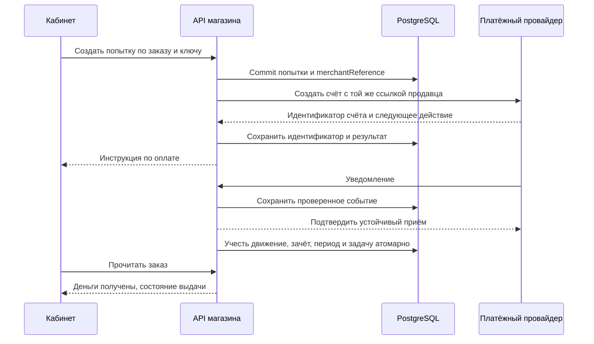

# Платежи, возвраты и сверка

**Назначение** — признать деньги один раз на конкретную внешнюю операцию, сохранить каждый фактический платёж и начислить право максимум один раз на заказ. Платёжный адаптер выбирается после проверки договора, рынка и стенда. Имена из существующего enum PaymentProvider отражают варианты из исходной схемы. [Исходные модели](../apps/api/prisma/schema.prisma#L277) · [ADR учёта](adr/0002-commerce-records.md)

## Модель и ключи

| Запись | Смысл и минимальные поля | Ограничения и поиск |
|---|---|---|
| MerchantAccount | Провайдер, test/live, merchant ID, канал, поддерживаемые валюты и операции, версия настройки, ссылка на защищённый секрет | Изоляция по провайдеру, среде и магазину. Смена ключа не меняет привязку исторических платежей. |
| PaymentAttempt | Намерение оплатить заказ, attemptId, orderId, accountId, merchantReference, ключ запроса, ожидаемые сумма/валюта, срок, статус, внешний invoice ID, разрешённое действие для клиента | merchantReference создаётся сервером до первого HTTP, уникален в аккаунте и стабилен на повторах этой попытки. UNIQUE(accountId, externalInvoiceId) для известных ID; индекс orderId/createdAt. |
| PaymentTransaction | Неизменяемая нормализованная операция провайдера — CAPTURE, REFUND, CHARGEBACK_DEBIT, CHARGEBACK_REVERSAL, комиссии/корректировки. Записываются внешний ID движения, тип, время у провайдера и получения, сумма, валюта, аккаунт, источник доказательства, связь с исходным движением | Уникальный семантический ключ движения внутри аккаунта. Если API повторно использует ID платежа для разных операций, состав ключа включает тип и стабильный ID конкретного движения. Несколько частичных возвратов различимы. Индексы на исходное движение и время операции для выгрузки. |
| ProviderEvent | Durable inbox. Аккаунт, eventKey, внешний тип/время, время получения, fingerprint проверенных данных, способ верификации, статус, ошибка, nextCheckAt | UNIQUE(accountId, eventKey). Одинаковый ключ с несовместимыми существенными полями отправить на разбор. При отсутствии event ID протокол адаптера должен определить устойчивый ключ. Хеш случайного JSON не обеспечивает дедупликацию денег. |
| OrderAllocation | Неизменяемая связь принятого capture с заказом, суммой, временем и основанием решения | Для первой версии один захват полной суммы: UNIQUE(orderId) и UNIQUE(captureTransactionId). Нераспределённые деньги остаются в журнале и попадают на сверку. |
| Refund | refundId, исходный capture, инициатор и причина, сумма/валюта, резерв суммы, merchantRefundReference, ID провайдера, статус, отдельное решение о правах | Уникальность локальной команды и внешней ссылки на возврат в merchant account. Индекс по capture и открытым статусам. Сумма подтверждённых и зарезервированных возвратов ограничена доступным остатком. |
| ReconciliationCase | Вид расхождения, ссылки на попытку/заказ/операцию, наблюдения обоих источников, владелец, приоритет, nextCheckAt, окончательное решение и срок ответа по делу | Один активный случай на аккаунт, объект и вид расхождения. Индексы status/nextCheckAt и merchantReference. История решений сохраняется. |
| Idempotency record | Команда, область пользователя/оператора, ключ, fingerprint канонического запроса, созданный объект и результат | UNIQUE(scope, operation, key). Другой запрос с тем же ключом — конфликт. Срок хранения должен покрывать договорный горизонт повторов; уникальные связи платежа и начисления сохраняются после истечения кэша ответов. |

Все суммы в учётной валюте хранятся целыми в минимальных единицах, со знаком, определяемым типом движения; наружу большие числа передаются строками. Масштаб валюты версионирован, XTR учитывается целыми Stars. Для криптоактива хранятся сеть, идентификатор актива, точность и целое число атомарных единиц с достаточной разрядностью (PostgreSQL numeric без плавающей точки). Предложение и фактическое движение могут иметь разные валюты только при сохранённой котировке с курсом, правилами округления и сроком. Суммы разных валют не складываются. Gross, комиссии и net settlement отчётны отдельно. Полные карточные данные и секреты не записываются в providerData или Audit.

## Протокол адаптера

| Операция | Контракт |
|---|---|
| createAttempt(reference, expected, expiresAt, key) | Возвращает типизированное действие — hosted checkout, локальную инструкцию или invoice. Возвращаемый домен и протокол проверяются по конфигурации. Для карт предпочтительна платёжная страница провайдера. |
| verifyEvent(raw, headers, account) | Проверяет требуемую контрактом подпись/секрет канала, исходные байты, merchant, test/live, допустимость времени и повтора. Возвращает нормализованный факт или требование подтверждения через API. При отсутствии надёжно аутентифицированного финального статуса требуется авторитетный pull. |
| getPayment / findByMerchantReference | Разрешает потерю ответа на create, пропущенный callback, частичное или неоднозначное подтверждение. Ошибки различают отказ, временную недоступность и неизвестный исход. |
| requestRefund / getRefund | Отдельная идемпотентная команда и поиск результата. Возможности полного/частичного возврата объявляются явно. Неподдерживаемая операция становится делом поддержки. |
| listMovements или statement import | Регламентная сверка по cursor/отчётному периоду с перекрытием окон. Каждое движение проходит ту же нормализацию и уникальные ограничения, что и webhook. |

Подтверждения браузера, query success=true, скриншот и само наличие invoice не являются источниками факта CAPTURE. Для любой записи проверяются аккаунт, среда, получатель, внешний платёж, связь с merchantReference, статус финальности, валюта и ожидаемая сумма. Ошибочные подписи отвергаются до занятия ключа доверенного события; сохраняется обезличенная диагностическая метрика. Для правильно аутентифицированного, но ещё несопоставленного уведомления — запись в inbox и ограниченный по времени разбор. Клиент видит ожидающий заказ и может запрашивать его текущий статус.

### Семейства каналов и ограничения

| Канал | Что дополнительно требуется до допуска |
|---|---|
| Карты и локальные методы | Различать создание, авторизацию, capture и settlement, если они предусмотрены контрактом. Для локального перевода проверить назначение и получателя. Зафиксировать окно ожидания, refund, dispute, комиссии и подтверждение банковского дня. |
| Криптопровайдер | Источник курса и срок котировки, корректная сеть/актив, политика подтверждений, reorg и финальность по договору, недо-/переплата и комиссии сети. Повтор наблюдения одной транзакции не создаёт новую продажу. Возврат только по процедуре провайдера с проверкой назначения и согласия, без автоматического вывода на произвольный адрес. |
| Telegram Stars | Отдельное решение для конкретного канала продажи цифровой услуги. До запуска проверить актуальные правила Telegram, допустимость продукта, страны, механику выдачи и возвратов. Задать валюту XTR, связать Telegram identity с владельцем заказа, сверять payload/сумму/покупателя на pre-checkout. Начисление запускает подтверждённый successful payment с устойчивым external charge ID. Ответ на pre-checkout лишь разрешает продолжить оплату. Проверить доступные API сверки и возврата по действующей документации. |

## Жизненный цикл и отказы

**Попытка.** Локальный INSERT даёт CREATED. Перед отправкой — SUBMITTING. Результат создания ведёт в AWAITING_CUSTOMER, PROCESSING либо FAILED для окончательного отказа. Неопределённый ответ ведёт в UNKNOWN и сверку. Только проверенный итог обработки денег переводит её в SUCCEEDED. Безденежное завершение — FAILED, CANCELED или EXPIRED. Внешний доказанный capture после такого завершения всё равно заносится в историю и передаётся на решение по заказу. Отличается переход исполнения заказа от факта поступления средств. Успешная попытка сохраняется успешной после возврата, связанное обратное движение имеет собственный статус.

**Событие.** VERIFIED → RECEIVED (устойчивый commit) → PROCESSED либо NEEDS_REVIEW. Временная ошибка оставляет RECEIVED с расписанием повтора. Ошибка привязки или конфликт идентификаторов открывает дело. После решения — повтор обработки либо RESOLVED с причиной. Варианты доставки с требованием быстрого ACK получают успех после durable commit inbox, далее обработчик доводит событие до результата. При синхронном учёте ACK отправляется после commit всей операции. Адаптер фиксирует выбранный протокол.

**Возврат.** REQUESTED → RESERVED под блокировкой исходного движения → SUBMITTED → CONFIRMED либо DECLINED. При сетевой неопределённости — UNKNOWN с сохранением резерва до подтверждённого исхода. Отмена резерва возможна до отправки либо после доказанного отказа. Проверенный внешний возврат, сделанный вне магазина, сразу учитывается как движение и сопоставляется с резервом или передаётся оператору. Уникальность внешней операции применяется в обоих путях.

**Спор.** OPEN → WON или LOST по проверенному решению. Списание или обратное зачисление фиксируется в момент соответствующего денежного факта, а не повторно при смене статуса дела. При конкуренции chargeback и refund под блокировкой пересчитать доступный остаток, изолировать спорные средства, остановить новые добровольные выплаты и сверить внешние движения. Даже неожиданный отрицательный остаток, реально проведённый провайдером, отражается отдельно для урегулирования. Факты истории не удаляются.

**Порядок обработки.** Сумма и валюта выбираются из серверного снимка. Повтор запроса создания возвращает сохранённую попытку. Если ответ провайдера потерян, магазин ищет по прежнему merchantReference либо повторяет тот же ключ при договорной гарантии. Если нет ни поиска, ни такой гарантии — UNKNOWN и ручная сверка; покупателю не предлагается бесконтрольно создавать второй счёт. При раннем webhook попытку можно найти по уже закоммиченному merchantReference. После авторитетного подтверждения в одной транзакции сохраняются финансовое движение, OrderAllocation, один PeriodGrant и задача синхронизации, outbox и окончательный статус inbox. Для лишнего или спорного платежа вместо allocation/grant создаётся дело. Отсутствие нового grant у такого платежа является проверяемым результатом.

## Особые случаи и доказательства приёмки

| Операция / сбой | Разрешение и наблюдаемый результат | Тест |
|---|---|---|
| Двойной клик или потеря HTTP-ответа магазина | Одинаковый ключ и payload возвращают ту же попытку. Новая разрешённая попытка имеет другую reference | Два конкурентных POST плюс повтор после commit. Один внешний счёт при идемпотентном провайдере. |
| Ответ create потерян, callback пришёл первым | Сопоставить merchantReference, сверить intent и внешний ID. Ответ позднего create не понижает подтверждённый статус. При противоречии — дело | Прервать ответ, доставить webhook, повторить checkout, сравнить ID, число движений и начислений. |
| Один и тот же capture прислан разными event ID или через statement | Уникальность движения защищает поверх дедупликации сообщения. Дубликат отмечается обработанным без новых эффектов | Перестановки событий, падение до commit и после него, повтор с новым event ID. |
| Два различных успешных платежа за один заказ | Под блокировкой заказа только один подходящий capture получает OrderAllocation. Второй факт учитывается как нераспределённый, заводится дело возврата | Одновременные callback от двух попыток: два движения, одна аллокация, один период. Возврат второй суммы сохраняет доступ. |
| Поздний webhook и поздняя оплата | По умолчанию подтверждённое providerPaidAt до expiresAt допускает зачёт после задержки доставки. Для оплаты на границе действует интервал до expiresAt исключительно. При платеже после окна, отменённом заказе или недоказанном времени — учёт денег и разбор | Проверить момент перед границей, саму границу и следующий момент, задержку уведомления, отсутствие достоверного времени. |
| Неверная сумма, валюта, аккаунт или неизвестная reference | Событие без доверия не получает зачёта. Доказанное поступление на наш счёт с расхождением остаётся нераспределённым. Чужие средства не включаются в журнал нашего merchant account | Проверить неверную подпись, аккаунт test/live, недоплату, переплату, несовпадение счёта и повторное добросовестное событие. |
| Два частичных возврата и неизвестный результат первого | Резерв и проверка доступного остатка под одной блокировкой до HTTP. Комиссии и фактическая сумма учитываются явно | Одновременный запрос сверх остатка получает отказ. При таймауте резерв сохраняется, средства учитываются один раз после сверки. |
| Полный возврат до выдачи или во время записи в панель | Подтверждение создаёт обратное движение и решение по праву в одном commit; новая desiredRevision и задача закрывают расхождение | Запоздалый ACK первоначальной выдачи не подтверждает новый профиль. Проверить остаток по другим покупкам. |
| Chargeback после продления, затем выигранный спор | Ссылки на исходный платёж, отдельные движения и Hold конкретного дела. Разрешение снимает только соответствующее основание | Оплатить последующий период, открыть и закрыть спор, повторить уведомления. Проверить баланс по валюте и независимость последующих покупок. |
| Потерян callback или остановка сверки в середине страницы | Job берёт период со стабильной пагинацией и перекрытием. Cursor продвигается только после устойчивого сохранения входных событий. Для отчётов сверяются gross/refunds/fees/net по валюте, дню и аккаунту | Удалить доставку тестового события, остановить обработку страницы. Следующий проход восстанавливает факт без двойного учёта. |

Журнал поддержки показывает orderId, merchantReference, ID движений, время события и подтверждения, статус распределения, суммы и расхождение с выпиской. Доступ ADMIN к ручному зачёту/возврату требует причины и идемпотентной команды. Для сумм выше согласованного порога возможен второй согласующий. Стандарты удержания сырых событий и ограничения полей определяются правилами канала и применимыми требованиями. Логи и уведомления не содержат платёжных секретов или URL VPN.

### Операционная сверка и контрольные равенства

Для каждого merchant account и валюты формируются три выборки: поступления с аллокацией, поступления без аллокации и обратные движения со ссылками на исходное. Сумма захватов равна сумме распределённых и нераспределённых захватов на одну контрольную точку. Подтверждённый возврат показывается по дате возврата, исходная выручка остаётся в периоде захвата. В отчёте движения денежных средств net рассчитывается из gross с учётом подтверждённых возвратов, дебетов/реверсов споров и комиссий в той же валюте. Валютный обмен и задержка выплаты продавцу — отдельные строки сверки. Расхождение временных зон, границ отчёта или курса фиксируется с основанием. Источник — отчёт провайдера либо согласованная выписка, по возможности независимо от канала webhook.

Открытое дело проходит OPEN → INVESTIGATING → RESOLVED с автором и доказательством; повторно найденное расхождение может открыть дело заново. Оператор видит разницу, возраст и срок следующей сверки. Ручное решение использует те же уникальные ключи и команды учёта. Финансовый аудит проверяет полноту по выписке и отдельно ищет аллокации без grant, grant без подтверждённого источника и незакрытые резервы. Компенсационные и импортированные права имеют свои явные основания. Проверка восстановления — воспроизвести страницу выписки дважды, затем пересчитать эти равенства и сравнить с исходными контрольными суммами.

## Как выбрать первый канал

Кандидат допускается к пилоту после подтверждения допустимости продажи VPN для продавца и целевых стран, расчётной валюты, KYC, сроков выплат, резервов, комиссий и порядка споров. Для технической приёмки потребуются sandbox, проверяемое подтверждение денег, устойчивые ID для повторов и возвратов, поиск после таймаута, источник сверки, правила ретраев и операционный контакт. Отсутствующую функцию записать как ограничение пилота и оценить ручную нагрузку. Продажа через Telegram требует отдельной проверки правил платформы на дату запуска.

**Вопросы владельцу.** Где зарегистрирован продавец и где находятся покупатели? Какие валюты и каналы нужны для первой продажи, какой мерчант и sandbox доступны? Обязательны ли частичные возвраты, фискальные документы и расчёты в криптоактивах? Кто принимает решение о позднем платеже, двойной оплате и споре, в какие сроки? Какие суммы требуют двойного согласования? Кто ежедневно разбирает несовпадения с выпиской? Выбор закрепляется отдельным решением после проверки договора и тестового платежа.

## COM-02 и Platega

Владелец выбрал Platega и RUB. Карты и СБП допускаются после подтверждения возможностей конкретного аккаунта. Окно COM-01 составляет 30 минут. Подготовленные методы и результаты mock относятся к локальному контракту VPNShop.

| Возможность | Статус Platega и требуемое доказательство |
|---|---|
| Merchant authentication и HTTPS | **UNKNOWN**. Получить официальный base URL, набор заголовков/ключей и область аккаунта. |
| Sandbox или тестовый merchant | **BLOCKED**. Нет подтверждённого адреса, тестового магазина и реквизитов. Проверить изоляцию ключей и запрет маршрутизации на production. |
| Создание, статус, поиск по reference | **UNKNOWN**. Получить точные запросы/ответы, набор статусов и channel IDs. До доказательства поиска или идемпотентности повторного POST при неопределённости нет. |
| Карты, СБП и денежный формат | **UNKNOWN** для аккаунта. RUB утверждён для магазина. Нужны подтверждение доступных методов и точный формат единиц и округления. |
| ID транзакции и денежного движения | **UNKNOWN**. Проверить область уникальности, устойчивость ID, отдельные идентификаторы возвратов/споров. |
| Webhook, аутентификация, ACK и повтор | **UNKNOWN**. Нужны официальный механизм проверки, идентичность события, формат ACK, резервы времени, доставка и повтор. При слабом сигнале денежный факт требует authenticated lookup. |
| Частичный/полный refund, chargeback, отчёт/список | **UNKNOWN**. Нужны фактические операции и связи в тестовом аккаунте. Сверка с перекрытием или импорт появятся после подтверждения источника и идентичности. |
| Лимиты, timeout, retry, идемпотентность | **UNKNOWN**. Нужны договорные лимиты, политика повторов и семантика ключей создания. |
| Авторизация, capture, settlement | **UNKNOWN**. Нужны авторитетное доказательство финального движения и отдельно условия settlement. Суммы магазина хранятся в minor units. |

Попытки получить публичные страницы вернули HTTP 403 от прокси до получения содержимого, в том числе при повторе с разрешением сети. Официальный контракт и merchant sandbox остаются **BLOCKED**. Проверенные адреса входа, содержимое которых не удалось получить: [сайт Platega](https://platega.io/) · [предполагаемый портал документации](https://docs.platega.io/). Ни mock-заголовок, ни fixture URL не относятся к API провайдера.

### Реализованный локальный протокол

- **IMPLEMENTED** C7 `POST /api/orders/:id/payments` требует пользователя, Origin, `Idempotency-Key` и `{channel:"CARD"|"SBP"}`. `GET /api/orders/:id/payments/:paymentId` возвращает состояние владельцу. Приватные ответы используют no-store. Создание в обычном runtime отвечает PAYMENTS_DISABLED, C5 возвращает пустые каналы. HTTP fixture доступен через явную инъекцию только при NODE_ENV=test и MerchantEnvironment.MOCK. [Маршруты](../apps/api/src/modules/payments/payments.routes.ts)
- **IMPLEMENTED** Payment хранит intent с уникальными ссылками и account scope. Строка заказа сериализует конкурентные команды. После commit SUBMITTING адаптер может выполнить один POST. При таймауте, некорректном redirect или падении до фиксации результата сохраняется или восстанавливается UNKNOWN, повтор использует прежнюю попытку. Новая попытка допускается после подтверждённого отказа без invoice при живом окне. `nextCheckAt` отсчитывается от часов PostgreSQL, поиск выполняется минутными проходами с пределом 48 часов и делом при исчерпании. REDIRECT требует HTTPS и точного origin адаптера. [Создание](../apps/api/src/modules/payments/attempts.ts) · [Сверка](../apps/api/src/modules/payments/reconciliation.ts)
- **IMPLEMENTED** `POST /webhooks/platega/:account` в fixture-режиме сохраняет аутентифицированную нормализованную проекцию с ID, reference, временем, суммой и связью движения. Только commit разрешает ACK. Обработка отдельным ограниченным проходом использует SKIP LOCKED. Сбой не оставляет частично учтённого движения, конфликт event key сохраняет второе наблюдение в деле. Ошибки обрабатываются с бюджетом 8 попыток, просроченные и исчерпанные записи остаются доступны для разбора. Отдельный scheduler реального провайдера зависит от sandbox. [Inbox](../apps/api/src/modules/payments/inbox.ts)
- **IMPLEMENTED** Append-only PaymentTransaction принимает одно нормализованное движение с одной семантической идентичностью per account из webhook и pull. Для несопоставленной операции сохраняется внешний факт без автоматической привязки. Case хранит тип, объект, диагностические поля, статус, следующий срок, приоритет и начальную запись истории. Ручное разрешение пока операционная процедура. Отдельный подтверждённый refund/chargeback сохраняется даже без оригинала. Связь разрешается по паре `accountId,originalMovementKey`, а дело остаётся открытым до разбора. [Учёт](../apps/api/src/modules/payments/ledger.ts)

### Вход для COM-03

Единица учёта — `PaymentTransaction.id` с типом CAPTURE и доказательством из допущенного аккаунта. `Payment.status` показывает состояние попытки, `Order.status` не меняется в COM-02. COM-03 должен взять блокировку строки заказа, перечитать ledger с сопоставлением аккаунта, внешнего платежа и reference, проверить точные условия, `providerTime < expiresAt`, отсутствие блокирующих событий inbox, обратных движений и открытых дел заказа/попытки/внешнего платежа/движения. В гонке с ingest требуется общий протокол блокировки либо проверенная серийная изоляция, включая обратные движения, для которых пока отсутствует связь с попыткой. Суммы, дата и источник capture берутся из журнала. Зачёт, grant, права, полномочия возврата и восстановление grantTime остаются в COM-03.

## Приём движения координатором COM-03

COM-03 принимает только сохранённый CAPTURE допущенного тестового аккаунта и проверяет ссылку на попытку, внешнюю идентичность, точные сумму и валюту заказа и окно `createdAt <= providerTime < expiresAt`. Явный EXPIRED остаётся в REVIEW. Если второй CAPTURE найден после зачёта, он сохраняется без нового права. Если конфликт уже известен до зачёта, открытое дело удерживает автоматическое решение. Связанный durable inbox проверяется до grant под общей блокировкой с приёмом webhook. Автоматический коммерческий зачёт и инициирование возврата требуют реальной приёмки аккаунта и согласования коммерческого процесса. [COM-03](subscriptions.md#реализация-com-03)

## Релизная проверка Platega

Внутренний journey повторяет webhook, подтверждает устойчивую запись до ACK, одну allocation и независимое одобрение refund intent. Это техническое доказательство закрытого локального пути. Platega sandbox, право на реальные вызовы и формат подтверждения от провайдера остаются BLOCKED. [Внешний gate](release-acceptance.md#commercial-release-gate)
