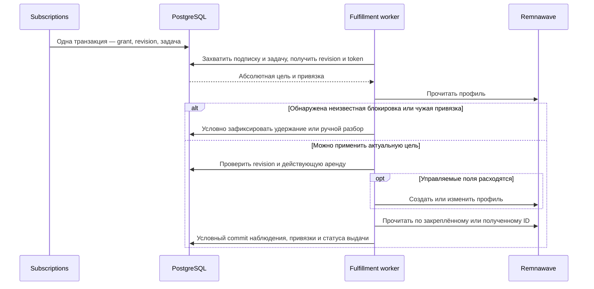
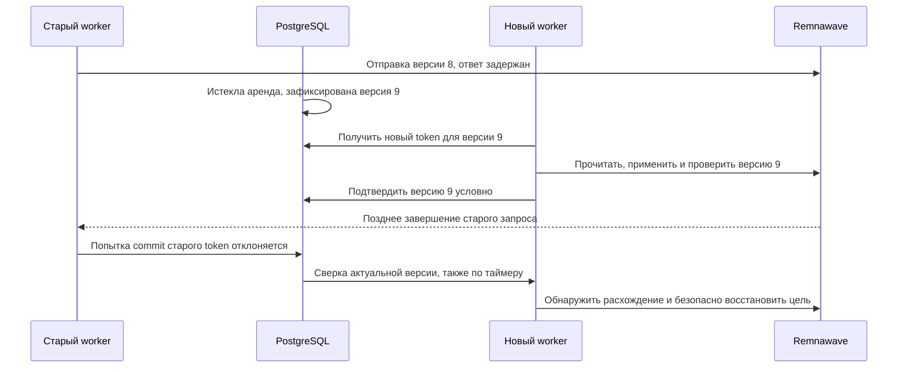

# Интеграция VPNShop с Remnawave и надёжная выдача подписок

Проектное решение Phase 3, 21 ноября 2026 года. База VPNShop — `33d9cd9`. Магазин ведёт оплаченные периоды в PostgreSQL. Панель получает рассчитанный на конкретный момент профиль пользователя. Готовность доступа для кабинета подтверждает отдельное чтение панели. Успешная запись профиля сама по себе не доказывает подключение устройства. [Архитектура](architecture.md) · [Правила подписок](subscriptions.md) · [ADR 0003](adr/0003-panel-convergence.md)

## Доказательная база и совместимость

| Что проверено | Результат и границы вывода |
|---|---|
| Официальный TypeScript-контракт | VPNShop фиксирует devDependency `@remnawave/backend-contract@3.4.17`. Опубликованная таблица ставит ему в соответствие панель **3.4.9**. Для 3.4.4–3.4.8 таблица указывает 3.4.15, для 3.4.0–3.4.3 — 3.4.13. Пакет экспортирует команды, маршруты и схемы Zod. В официальном примере HTTP выполняет Axios, с серверным Bearer-токеном и маршрутом из команды. [Таблица и пример TypeScript][tsdocs] · [Публикация npm][npm17] · [Зависимости VPNShop](../apps/api/package.json) |
| Официальный backend | Для матрицы ниже прочитаны команды, схемы и обработчики тега 3.4.9 (`01a4059`), методы и пути также получены из экспортов установленного npm-пакета. У проверенного более нового тега 3.4.11 (`6853666`) дерево `libs/contract` идентично (`018d4815`), пакет в нём также имеет версию 3.4.17. Файл сервиса пользователей совпадает. Это свидетельство на уровне исходников. Строка совместимости с 3.4.11 в прочитанной таблице отсутствует. [Контракт 3.4.9][tree9] · [Контракт 3.4.11][tree11] · [Сервис 3.4.11][service11] |
| Публикации и примеры | При проверке npm указывал `latest=3.4.20`. Этого факта недостаточно для обновления pin или выбора образа панели. Сайт документации/Swagger возвращал HTTP 403 из этой среды. Использованы доступные официальный репозиторий документации, исходники команд и npm. Swagger размещён по ссылке из документации. Пример в официальном Python SDK подтверждает существование отдельного клиента, его таблица старше проверяемой серии. [Реестр][npmall] · [Swagger][swagger] · [Исходники документации][docsrepo] · [Примеры Python][python] |
| Установленная панель | Версия, git SHA, конфигурация HWID, доступность узлов и разрешения ключа на конкретной установке не установлены. В репозитории нет закреплённого образа внешней панели. Контрактные тесты обращаются к фикстурам. Проверка при подключении стенда должна снять `response.version`, `build`, `git.backend.commitSha` из metadata, сопоставить с образом/digest оператора и выполнить сценарии приёмки ниже. [Metadata][meta] · [Compose магазина](../docker-compose.yml) |

## Матрица API

Версия **каждой строки** — контракт **3.4.17**, официальный backend **3.4.9**. Ссылка в строке ведёт к определению запроса и ответа этой версии. Это серверный management API. Успешные JSON-ответы рассмотренных команд содержат обёртку `response`. Расширенный пользователь включает числовой `id`, `username`, статус, `expireAt`, лимиты, `activeInternalSquads`, `userTraffic` и приватный `subscriptionUrl`. Прикладной DTO выбирает только поля конкретной операции. [Маршруты][routes] · [Расширенная модель][extended] · [Базовая модель][user]

| Операция | Метод и путь | Контракт, ограничения и применение в VPNShop |
|---|---|---|
| Проверить сборку | `GET /api/system/metadata` | Версия, build и сведения git. Использовать при старте и после смены образа. [GetMetadata][meta] |
| Создать | `POST /api/users/` | Обязательны уникальный `username` (3–36 ASCII-букв, цифр, `_`, `-`) и `expireAt` в ISO. Можно задать статус, лимиты и UUID групп. Ответ 201 с пользователем. Ожидаемый внешний ID берётся из ответа и сверяется чтением. [CreateUser][create] · [Контроллер][controller] |
| Найти закреплённого пользователя, прочитать статус и сверить | `GET /api/users/:userId` | Числовой ID панели. Сверить также username, экземпляр панели и связь с локальной подпиской. Статусы чтения — `ACTIVE`, `EXPIRED`, `DISABLED`, `LIMITED`. Нет гарантии работы конкретного узла. [GetUserById][byid] · [Статусы и поля][user] |
| Найти по имени | `GET /api/users/by-username/:username` | Тот же тип ответа. Нужен при первом создании и разборе потерянного ответа. Совпадение одного имени недостаточно для присвоения чужого аккаунта. [GetUserByUsername][byname] |
| Установить дату окончания и поля профиля | `PATCH /api/users/` | Передавать ровно один идентификатор (в магазине — `id`). Текст команды требует один, Zod проверяет наличие хотя бы одного. Опциональный `expireAt` должен быть в будущем. Записывать абсолютное UTC-время. Для завершившегося права сверять истечение/выключение, исключить отправку прошлой даты. Ручные значения поля `status` в PATCH ограничены ACTIVE и DISABLED. [UpdateUser][update] · [Поведение сервиса][service] |
| Продлить на дни | `POST /api/users/:userId/actions/extend` | `{days}`, число ≥ 1. ACTIVE продлевается от имеющегося конца, EXPIRED — от текущего времени с активацией. Для DISABLED/LIMITED команда сохраняет статус. Относительная команда не подходит для повтора выдачи или календарных месяцев. [ExtendUser][extend] |
| Назначить лимит устройств и проверить занятые устройства | `POST /api/users/`, `PATCH /api/users/`, `GET /api/hwid/devices/:userId` | `hwidDeviceLimit` — целое ≥ 0, в PATCH допустим также null. Пропуск при обновлении сохраняет поле. В обработчике 3.4.9 ноль отключает проверку лимита для этого пользователя, null использует настроенный fallback. На стенде проверить фактический режим установки. Список устройств содержит `total` и `devices`. Выдаче достаточно лимита. HWID выключен по умолчанию, ограничение действует при получении конфигурации поддерживаемым клиентом. Число одновременных туннелей этот контракт не измеряет. [Create][create] · [Update][update] · [GetUserHwidDevices][hwidlist] · [Правила HWID][hwid] · [Обработчик HWID][subservice] |
| Трафик и стратегия сброса | `POST /api/users/`, `PATCH /api/users/` | `trafficLimitBytes` ≥ 0, 0 означает безлимит. `trafficLimitStrategy` принимает NO_RESET, DAY, WEEK, MONTH, MONTH_ROLLING. Параметры задаёт снимок тарифа. Увеличение квоты или переход на 0 для LIMITED может активировать доступ. [Create][create] · [Update][update] · [Enum][periods] · [Сервис][service] |
| Сбросить счётчик | `POST /api/users/:userId/actions/reset-traffic` | Команда по ID, возвращает профиль. Повтор может стереть уже новый расход. Отдельная административная операция с основанием и разбором неизвестного результата. Обычное продление её не вызывает. [ResetUserTraffic][reset] |
| Прочитать использование | `GET /api/users/:userId`, `GET /api/bandwidth-stats/users/:userId` | В первом ответе `userTraffic.usedTrafficBytes`, `lifetimeUsedTrafficBytes`, nullable `onlineAt`, `firstConnectedAt`, `lastConnectedNodeUuid`. У второго обязательны `start`, `end` в формате YYYY-MM-DD, `topNodesLimit` ≥ 1, по умолчанию 20. Ответ содержит `categories`, `sparklineData`, `topNodes`, `series`. Данные годятся для кабинета с временем получения. Контракт не задаёт задержку агрегирования. [GetById][byid] · [UserTraffic][traffic] · [GetStatsUserUsage][stats] |
| Получить subscription URL | `GET /api/users/:userId` или `GET /api/subscriptions/by-id/:userId` | Для кабинета достаточно первого запроса. У второй команды имя `GetSubscriptionByIdCommand`, в `response` есть `isFound`, `user`, `subscriptionUrl`, а также приватные `links` и `ssConfLinks`. Обрабатывать наличие и статус, передавать владельцу только валидированную ссылку. URL формирует панель. [GetById][byid] · [GetSubscriptionById][sub] · [SubscriptionInfo][subinfo] |
| Отключить доступ | `POST /api/users/:userId/actions/disable` | Тело не требуется, ответ с пользователем. При повторе возможен ответ 400/A029 «уже отключён». Требовать подтверждения статуса последующим чтением. Удаление записи не является частью блокировки. [DisableUser][disable] · [Сервис][service] |
| Восстановить доступ | `POST /api/users/:userId/actions/enable` | Тело не требуется, ответ с пользователем. Выполнять только после решения о снятии конкретного удержания при действующем праве. Возможен ответ 400/A030 «уже активен». Сервис отдельно инициирует обновление узлов. [EnableUser][enable] · [Сервис][service] |
| Получить группы и управлять членством | `GET /api/internal-squads/`, `POST /api/users/`, `PATCH /api/users/` | Список `total/internalSquads`. В профиле `activeInternalSquads` — массив UUID при записи, объекты групп при чтении. PATCH задаёт весь набор, пустой массив очищает, пропуск сохраняет. `externalSquadUuid` — отдельное необязательное поле. Сопоставление версии тарифа и разрешённых внутренних групп хранить на сервере. Включать управление полным набором только при согласованном владении им. [GetInternalSquads][squads] · [Create][create] · [Update][update] · [Сервис][service] |
| Проверить доступные узлы | `GET /api/users/:userId/accessible-nodes`, `GET /api/internal-squads/:uuid/accessible-nodes` | Ответы содержат соответственно `userId/activeNodes` и `squadUuid/accessibleNodes`, с идентификаторами узлов и информацией о профилях. Пригодно для проверки маршрутизации тарифа через группы. Прямая коллекция node UUID для назначения пользователю в Create/Update отсутствует. [Узлы пользователя][unodes] · [Узлы группы][snodes] · [Update][update] |
| Обнаружить удаление, разобрать пропавшую привязку | `GET /api/users/:userId`, `GET /api/users/by-username/:username` | Оба GET вызывают getUserByUniqueFields. При отсутствии записи сервис выдаёт 404 с errorCode A063. Проверить по привязанному ID, диагностировать по имени. Официальное удаление — `DELETE /api/users/:userId` (204). Эту команду адаптер магазина не использует. При исчезновении закреплённого ID сохранить привязку и приостановить выдачу до решения оператора. [GetById][byid] · [GetByUsername][byname] · [DeleteUser][delete] · [Коды ошибок][codes] · [Контроллер][controller] |
| Ротация раскрытой ссылки | `POST /api/users/:userId/actions/revoke` | По умолчанию панель генерирует новый short UUID. `revokeOnlyPasswords=true` оставляет short UUID и URL. Ротация разрывает использование старых реквизитов и требует отдельного запроса, проверки результата и повторного импорта в клиент. [RevokeUserSubscription][revoke] |

## Что делает VPNShop сегодня

| Участок | Наблюдение в исходниках | Значение для выдачи |
|---|---|---|
| Транспорт и разбор | Реализованы пять команд — metadata, список групп, GET по username, create и update. Deadline по умолчанию 30 c на запрос. GET повторяется до двух раз с паузами 300/600 мс при временной ошибке. Транспорт отправляет POST/PATCH один раз за вызов. Локальная Zod-схема читает часть полей, включая `trafficLimitBytes`, `shortUuid` и URL. Стратегию трафика и статистику она отбрасывает. | Нужны GET по ID и раздельные проекции для сверки и выдачи секрета. Ошибка разбора после записи, в том числе при обрыве тела ответа, оставляет исход записи неизвестным. [Клиент](../apps/api/src/modules/remnawave/remnawave.client.ts) · [Схемы](../apps/api/src/modules/remnawave/remnawave.schemas.ts) |
| Старт | Проверка metadata считает совместимой всю серию 3.4 и только журналирует отсутствие групп/несовпадение. Worker запускается перед завершением проверки. | Получение денег/кабинет и готовность интеграции к записям должны иметь разный статус. Для неподтверждённой пары версий, неправильного окружения и недоступных групп требуется отдельное решение по готовности выдачи соответствующего тарифа. [Совместимость](../apps/api/src/modules/remnawave/remnawave.compat.ts) · [Старт](../apps/api/src/server.ts) |
| Привязка | `User.remnawaveUserId Int? @unique` записывается при завершении. Все рабочие поиски выполняются по детерминированному `vs_` + UUID без дефисов. Любой HTTP 404 при поиске превращается в «отсутствует». Любой `rejected` при создании ведёт к повторному поиску и возможному принятию совпадения. | Возможны создание после удаления оператором, неверная привязка при коллизии или путанице инсталляций. Нужен контроль числового диапазона и устойчивое доказательство привязки. [Prisma](../apps/api/prisma/schema.prisma) · [Имя](../apps/api/src/modules/remnawave/remnawave.username.ts) · [Применение](../apps/api/src/modules/remnawave/remnawave.provisioning.ts) |
| Срок и повтор | Первая попытка считает `addMonthsUTC(max(now, panel.expireAt), months)` с ограничением дня концом месяца, сохраняет `targetExpireAt`, затем отправляет абсолютное значение. Для одинаковой цели повторное применение не добавляет месяц. | Сохранить чистую календарную функцию. Источник исходного интервала перенести в локальный журнал прав. Сейчас CAS «записать дату, пока null» не проверяет число обновлений, проигравший процесс продолжает со своим расчётом. [Даты](../apps/api/src/modules/remnawave/remnawave.dates.ts) · [Processor](../apps/api/src/modules/fulfillment/fulfillment.processor.ts) · [Очередь](../apps/api/src/modules/fulfillment/fulfillment.queue.ts) |
| Применение профиля | Создание задаёт ACTIVE, срок, HWID, группы, по умолчанию безлимит и NO_RESET. При продлении пишутся срок и HWID, для прочитанного EXPIRED явно посылается ACTIVE. DISABLED получает новую дату и отметку `stillDisabled`. Заказ завершается как FULFILLED. LIMITED отдельного разбора не имеет. | Между чтением EXPIRED и записью ACTIVE оператор может поставить запрет. Отметка FULFILLED также возможна при неработающем доступе. Необходимо различать финансовый зачёт, удержание и подтверждённую выдачу. [Применение](../apps/api/src/modules/remnawave/remnawave.provisioning.ts) · [Завершение](../apps/api/src/modules/fulfillment/fulfillment.processor.ts) |
| Очередь | Уникальный job на orderId. В захвате `NOT EXISTS` по предшественникам стоит **до LIMIT 1**, используется `FOR UPDATE ... SKIP LOCKED`. Старой выборки первых 25 кандидатов здесь уже нет. Таймаут владения 5 мин, до 50 задач за проход, опрос через 3 с. Перезапуск возвращает просроченный RUNNING в очередь. | После перезахвата старый исполнитель всё ещё может завершить/переотложить задачу по её ID. В общей транзакции завершения результат условного изменения PAID также не проверяется. FAILED-предшественник блокирует следующие заказы этого пользователя. Периодическая сверка уже завершённых задач отсутствует. [SQL и переходы](../apps/api/src/modules/fulfillment/fulfillment.queue.ts) · [Worker](../apps/api/src/modules/fulfillment/fulfillment.worker.ts) · [Константы](../apps/api/src/modules/fulfillment/fulfillment.constants.ts) |
| Ошибки и тесты | Классификация HTTP отделяет временные ошибки, отказ и ошибки оператора. Фрагмент внешнего сообщения может попасть в `lastError` и журнал. Контрактные тесты сравнивают пути и тела, несколько методов и один DTO с официальной схемой. | Отсекать тела внешних ошибок. В этой фазе запущен `vitest run src/modules/remnawave` из apps/api — **3 файла, 40 тестов прошли**, включая повтор одной цели и потерю ответа на create в памяти. Тест с падением после изменения панели есть и в интеграционном наборе. В Phase 1 Prisma engine вернул 403, тогда 5 интеграционных файлов не исполнили assertions. Здесь отсутствует результат прогона против развёрнутой панели. [Контрактные тесты](../apps/api/src/modules/remnawave/remnawave.contract.test.ts) · [Тесты выдачи](../apps/api/src/modules/remnawave/remnawave.provisioning.test.ts) · [Интеграционные сценарии](../apps/api/src/modules/fulfillment/fulfillment.int.test.ts) · [Аудит](audit.md) |

## Граница адаптера и данные PostgreSQL

Fulfillment получает от Subscriptions идентификатор подписки и ревизию назначения. У него нет команды начислить дни или изменить платёж. Цель включает panelInstance, состояние допуска, абсолютный конец текущего непрерывного покрытия, HWID, квоту, стратегию и управляемые группы. Граница будущего изменения условий планируется в БД. При задержке за эту границу исполнитель заново читает действующее назначение. Причинённая задержкой потеря срока разбирается отдельной компенсацией с уникальным основанием. [Правила времени и компенсаций](subscriptions.md) · [Финансовая граница](payments.md)

| Данные | Ограничение и назначение |
|---|---|
| PeriodGrant, ServiceHold, DesiredAssignment | UNIQUE(orderId) для начисления по покупке. Под блокировкой подписки один раз зафиксировать начало, конец, условия и следующую revision. Неизменяемый снимок UNIQUE(subscriptionId, revision). Раздельные удержания магазина и обнаруженной ручной блокировки. |
| PanelBinding | Одна текущая привязка на подписку, UNIQUE(panelInstance, remoteUserId) и резерв имени UNIQUE(panelInstance, username). Сохранить историю замены ID и ссылку на решение оператора. PanelInstance — локальная стабильная идентичность инсталляции, смена адреса/базы требует проверки. ID — число панели. shortUuid служит для конфигурации и непригоден как ключ БД. Сопоставить текущий SQL Int32 с внешним BigInt и JSON number. При миграции проверить диапазон, хранить точное целое достаточной ширины, отвергать небезопасное для JS целое до обращения к чужому аккаунту. [Схема магазина](../apps/api/prisma/schema.prisma) · [Модель панели][user] · [Реализация lookup][service] |
| SyncCursor и job | Одна строка аренды на подписку для всех ревизий. Поля — owner, монотонный token, leaseUntil по часам БД, запрошенная revision, mode (apply/verify), attempts, nextAttemptAt, категория ошибки. Уникальная задача на подписку и ревизию или эквивалентная дедупликация. Индекс по состоянию и nextAttemptAt. Частые сигналы сверки можно объединять. |
| PanelObservation | panelInstance, remoteUserId, username, прочитанные управляемые поля, статус, observedAt, revision и token попытки. Сравнивать UTC-время с согласованной точностью и UUID как множество. Различать null, 0 и пропуск в командах. Хранить matchedRevision и свежесть отдельно. Не сохранять extended user, URL, shortUuid, ключи протоколов или список устройств. |

**Интерфейсы.** Транспорт отвечает за фиксированный HTTPS origin панели, серверную авторизацию, deadline, ограниченный размер ответа, декодирование envelope и типизированные ошибки. Адаптер предоставляет чтение metadata, групп и профиля по ID/имени, создание, установку конкретных полей, отключение и санкционированное включение. Сравнение нормализованных полей, решение об удержании и история попыток принадлежат Fulfillment. Отдельный интерфейс чтения ссылки доступен сервису кабинета. Статистика и административная ротация имеют собственные DTO и разрешения. Использовать собственные узкие runtime-схемы и pinned dev-контракт в CI, как в текущем клиенте. Заголовки доверенного прокси формирует инфраструктура. Для инсталляций с дополнительной защитой учитывать отдельный секрет reverse proxy. [Официальный пример клиента][tsdocs] · [Пример защиты панели][proxy]

**Первичная привязка.** До HTTP зарезервировать в БД имя, инсталляцию и уникальную операцию создания. Существующий незакреплённый аккаунт с таким именем отправить на разбор. Для восстановления после потери ответа можно зарезервировать с владельцем панели поле для непрозрачной корреляционной метки магазина (например, `description`), записывать её при create и проверять при GET вместе с именем, инсталляцией и единственностью привязки. Метка не секрет и требует контроля прав записи в панели. Для legacy, неоднозначного владения, сменившегося ID или отсутствующей метки автопривязка запрещена. После каждого успешного создания закреплять ID и подтверждать профиль условно в БД. При редком конфликте уникальности сохранить дело для разбора, прежде чем менять любой профиль. [Create][create] · [Read][byid]

## Протокол выдачи

1. Зачёт покупки, изменение права, новая версия цели и постановка задачи фиксируются одной короткой транзакцией. Время начала периода берётся один раз по правилам Phase 2. Два оплаченных заказа сериализуются на одной подписке, каждый создаёт один период. Дублирующее уведомление возвращает прежний grant. Подтверждение панели не создаёт период. [Порядок начисления](subscriptions.md)
2. В транзакции выбора применять SKIP LOCKED к готовой работе, сохранить фильтрацию блокирующих строк до LIMIT. Атомарно захватывать **общую аренду подписки**, увеличивать token при каждой выдаче владения, фиксировать nextAttemptAt, revision и срок. Обычный HTTP выполняется вне транзакции. Отдельно сериализовать локальные изменения права, чтобы остановленный worker не мешал возврату или запрету.
3. Сверить параметры и ID, прочитать пользователя. Связанный пользователь всегда ищется сначала по ID. Допустима запись только полей, которыми управляет магазин. При точном совпадении чтения достаточно. Для добровольно предоставленного панелью более длинного срока без объяснимого происхождения открыть расхождение, не укорачивать его обычной покупкой. Для укорочения после возврата требуются отдельное основание, действующая revision и сохранение последующих прав. Если доступа сейчас нет, отсутствующего нового пользователя создавать незачем. Для уже существующего с истёкшим правом проверить фактический EXPIRED или отключить и подтвердить безопасный статус. PATCH с прошедшим сроком непригоден.
4. Непосредственно перед каждым внешним изменением перечитать revision, удержания и владение. Продлевать lease только по owner/token и пока он действителен. Остаток аренды должен покрывать deadline плюс время фиксации. Иначе отказаться от отправки. Записывать intent попытки до отправки. Между шагами проверять цель снова, число запросов ограничить. Обычное продление обновляет только отличающиеся абсолютные поля. Не прикладывать явный ACTIVE к плановому PATCH. Специальные переходы статуса рассмотрены ниже.
5. После изменения прочитать по ID и сравнить статус, срок, HWID, квоту, стратегию и полный **управляемый** набор групп. Для запрета первичным критерием является закрытый доступ. Остальные расхождения сохранить для будущего разрешённого применения. В короткой транзакции проверить актуальную revision и условие владения (subscriptionId, owner, token, leaseUntil ещё в будущем, ожидаемый статус). Только при одном обновлении сохранить привязку/наблюдение/подтверждение и событие кабинета атомарно. Ноль строк — результат проигравшей попытки, поставить или сохранить запрос сверки текущей цели. Та же проверка обязательна для fail, retry и продления аренды.
6. При падении до commit начисления БД откатывает всю операцию. После commit задача переживает перезапуск. После захвата без завершения аренда истекает. Новый исполнитель **сначала читает**. После внешней записи и до локального commit применяется тот же протокол. Корректный read-back может завершить работу без повторного PATCH. Если профиль ещё расходится, повторно допускается только актуальная абсолютная операция. Если право или идентичность сомнительны, открыть разбор.

**Граница гарантии.** Локальный token исключает поздний commit в PostgreSQL. У панели 3.4.9 нет документированного и реализованного в рассмотренном пользовательском маршруте сравнения revision при записи. Уже отправленный старый запрос может дойти после нового. Периодическая сверка исправляет допустимые расхождения после восстановления связи. Максимальный промежуток неверного доступа зависит от задержек, расписания и ручных удержаний. При строгом требовании непрерывности административного запрета нужен общий порядок записи, обязательный и для других писателей, или условная запись upstream. Для критического запрета немедленно закрыть локальную выдачу ссылки, повторно проверить панель после затихания запросов и эскалировать просрочку. [Update][update] · [Контроллер][controller] · [Сервис][service]

**Инвариант повтора.** Пусть заказ дал полуоткрытый интервал с концом E, а работа revision R содержит E. Каждая повторная отправка устанавливает одно значение E. В цепочке нет операции «добавить дни к ответу панели». Это даёт один grant и постоянный срок для одного заказа даже после исчезновения ответа. Два разных заказа законно фиксируют разные границы в журнале. Повтор R после R+1 не вправе изменить журнал или утвердить старое наблюдение. Риск временно устаревшей даты во внешней панели остаётся до сверки. Существующий тест трижды применяет одну цель к fake panel и проверяет неизменность даты. Полный случай с двумя арендами требует интеграционного испытания. [Исполняемый тест](../apps/api/src/modules/remnawave/remnawave.provisioning.test.ts) · [ADR](adr/0003-panel-convergence.md)

### Ручная блокировка, LIMITED и удаление

* **DISABLED при активном праве.** Сразу закрыть выдачу ссылки, сохранить причину «панель отключила, происхождение неизвестно», observation и локальный hold условно для текущей привязки. До решения оператора заморозить записи профиля. Оплаченные периоды продолжают учитываться локально, кабинет показывает «оплачено, доступ приостановлен». Уведомить поддержку с ID дела без реквизитов подключения. Если открыт запрет магазина и панель уже DISABLED, цель закрытия выполнена, происхождение возможного дополнительного внешнего запрета остаётся неизвестным.
* **Снятие.** Отдельное полномочие администратора, повторная аутентификация, основание и журнал. Перечитать остальные hold, право по времени, инсталляцию и ID. При неопределённости уточнить с оператором панели состояние и авторство. Обновить разрешённые поля под запретом, проверить их, затем отдельным разрешённым действием enable и повторным чтением подтвердить ACTIVE. Конкурирующие ручные изменения самой панели остаются предметом ограничений CAS. Снятие запрета вручную в панели само по себе не закрывает дело магазина.
* **EXPIRED и LIMITED.** В backend 3.4.9 изменение EXPIRED на новую будущую дату без явного status способно вернуть ACTIVE. При LIMITED увеличение квоты или назначение безлимита также может вернуть ACTIVE. Для продления разрешать такое изменение только при действующем праве и отсутствии удержаний. При LIMITED по исчерпанию трафика показать ограничение и политику следующего сброса. Ошибочное выставление ACTIVE или reset-traffic меняет коммерческие условия. При расхождении с политикой — разбор. [Реализация переходов][service]
* **Удаление.** Достоверный 404/A063 при GET по привязанному ID переводит синхронизацию в MISSING/NEEDS_REVIEW. Приостановить выдачу. Проверить по имени, записать историю, различать сознательное удаление, переименование, подмену инсталляции и восстановление базы из backup. Новая привязка — отдельное авторизованное решение с проверкой прав, старого и нового ID и актуального срока. Новый платёж не нужен. Отказ публичной ссылки, включая HWID-ограничение, не доказывает удаления пользователя. [Коды панели][codes] · [Правила HWID][hwid]

## Ошибки, повторы и сверка

В очереди различать READY, RUNNING, RETRY_WAIT, VERIFY_PENDING (результат записи неизвестен), CONFIRMED, SUPERSEDED и NEEDS_REVIEW. Истечение аренды переводит незавершённую попытку записи в режим проверки. Возобновление после NEEDS_REVIEW сохраняет историю попыток и берёт последнюю revision. RUNNING и NEEDS_REVIEW не меняют состояние денег.

| Наблюдение | Категория адаптера | Следующее действие |
|---|---|---|
| Некорректный id, UUID, прошедший target, неверный снимок групп | InvalidDesired / StaleDesired | Перечитать текущую границу права. Ошибку модели изолировать по тарифу, старую версию погасить. Исправление публикует валидное назначение. |
| 401/403 от панели или защитного прокси | AuthOrProxy | Приостановить запись для инсталляции, оповестить оператора. Возобновлять после контрольного чтения metadata и разрешённых ресурсов. Не повторять все задачи на неверном ключе. |
| A063 + 404 от GET по ID/имени. A025 + 404, например, при PATCH или поиске subscription info | UserMissing | Для новой резервации допускается создание после проверки идентичности. Для уже связанного ID — MISSING и разбор. После A025 на изменении сначала проверить закреплённый ID отдельным GET. HTML 404, другой errorCode и 404 другой операции классифицировать отдельно как ошибку маршрута/инфраструктуры. [Коды][codes] · [Реализация lookup][lookup] · [Фильтр ошибок][errfilter] |
| A019 + 400 при create или иной отказ валидации | NameConflict / Rejected | При A019 проверить только исходный intent, имя, метку и привязку. Не присваивать найденный аккаунт по одному совпадению. Остальной постоянный 4xx разбирать по операции и allowlist кода, без повторов неизменного тела. [Каталог кодов][codes] |
| Отключение/включение вернуло «уже в этом состоянии» | CandidateMatch | Подтвердить чтением по ID и текущим локальным основанием. Ошибка другого пользователя или конфликтная ручная блокировка не считается выполнением. [Сервис][service] |
| 408, 429, 5xx, сетевой сбой или таймаут | ReadTransient при GET, WriteUnknown после отправки изменения | Чтение повторить по backoff. После изменения прежде любой повторной записи установить VERIFY_PENDING, сверить фактическое состояние. При 429 уважать валидный Retry-After, если он есть. Ограничивать параллелизм на инсталляцию. Не предполагать, что 500 доказывает откат внешнего изменения. [Ошибки после создания][codes] |
| 2xx с неподходящей схемой, недочитанным телом, несовпадающим ID или неподдерживаемая сборка | SchemaMismatch / IdentityConflict | Остановить автоматическую запись для затронутого профиля/сборки, сохранить безопасную диагностику. После записи исход неизвестен. Переключить на read-back, возобновлять мутации только когда схема/привязка подтверждена. |
| Подозрение на ротацию/сброс трафика с потерянным ответом | NonRepeatableUnknown | Автоматически не повторять. Открыть дело, сверить `subRevokedAt` или `lastTrafficResetAt`, доступные свидетельства и текущее состояние. Когда происхождение изменения неизвестно, результат подтверждает оператор. [Поля наблюдения][user] |

**Параметры повторов.** Сейчас worker допускает до 15 попыток временной ошибки, начинает с 15 с, добавляет ±20% после ограничения базовой паузы 30 мин (возможны 36 мин). Для ошибок оператора предусмотрен повтор через 10 мин. Предложение для нового worker — один владелец бюджета повторов на задачу, явные deadline на попытку и чтение тела, случайная пауза в пределах от половины до полной величины `min(cap, base × 2^(attempt−1))`. В качестве начальных base/cap сохранить 15 с / 30 мин. Retry-After в будущем ограничивает самый ранний следующий запрос. Для длинной паузы сохраняется время в БД. Один проход выполняет максимум одно внешнее изменение, остальные сетевые попытки учитываются явно. После исчерпания бюджета — уведомление и NEEDS_REVIEW, чтение при восстановлении продолжается. При массовом сбое достаточно контрольной пробы на инсталляцию с постепенным возобновлением очереди. [Текущий backoff](../apps/api/src/modules/fulfillment/fulfillment.backoff.ts) · [Константы](../apps/api/src/modules/fulfillment/fulfillment.constants.ts)

**Независимая сверка.** Отбирать порциями по индексируемому nextCheckAt и стабильному ID, включая CONFIRMED, удержания и MISSING. Переносить курсор и учитывать квоту API. Приоритет имеют просроченные отключения, неизвестные исходы, смена тарифной границы, затем давно не проверенные подтверждения. Исходное предложение для настройки на стенде — попытка сверки неизвестной записи сразу при возобновлении связи, запрета в течение минуты при доступной панели, остальных подтверждений в пределах суток с разбросом. При N подписках и периоде T требуется не менее N/T чтений в секунду плюс резерв на выдачу. Согласовать T с допустимым временем ошибки и фактической ёмкостью панели. Не устанавливать matchedRevision по неудачному GET. Старый ответ или устаревшее наблюдение не перетирает более новое. Закрытие обхода, возраст старейшего расхождения, задержку отключения, число потерянных lease и причины отказа видеть в метриках без ссылок и пользовательских идентификаторов в labels.

**События панели.** Опциональные `user.disabled`, `user.deleted` и другие события ускоряют постановку сверки. Проверять HMAC-SHA256 по исходным байтам тела до JSON-разбора, сравнивать подпись в постоянное время, соответствие времён в заголовке и подписанном теле, допустимое окно, ограничение тела и повтор по отпечатку. Проверить сериализацию на фикстуре реального отправителя до включения. Хранить минимум данных и ссылку на локальное дело. Пропуски, повторы и перестановки событий покрывает периодический GET. При валидном сигнале о запрете можно временно закрыть выдачу ссылки до чтения. Событие само по себе не идентифицирует автора решения и не изменяет оплаченные периоды. [Формат и примеры проверки][events] · [Официальный отправитель][sender]

## Получение конфигурации владельцем

1. Предлагаемый маршрут магазина — `POST /api/me/subscription/access`, пустое тело. Действующая пользовательская сессия, проверка её отзыва, same-origin и CSRF по правилам cookie-сессии. Владелец определяется только на сервере. Выбирать подписку вместе с binding по subscription.ownerId = session.userId. При нескольких подписках в будущем оба условия проверяются одним запросом. Никакой числовой ID панели, username, чужой userId или произвольный URL от браузера не участвует в поиске. Административная сессия сама по себе доступа к секрету покупателя не даёт. Ограничить частоту раскрытия на сессию/аккаунт. [Аутентификация магазина](../apps/api/src/modules/auth/authenticate.ts)
2. Проверить право на текущий момент, отсутствие любого удержания, текущую подтверждённую версию и связь с нужной инсталляцией. Перед раскрытием получить пользователя по закреплённому ID, сверить ID, имя, ACTIVE, будущий срок и управляемый профиль. При дрейфе — поставить сверку. Проверить сервером на выходе схему HTTPS, разрешённые домены/порты **публичной подписки этой инсталляции**, отсутствие userinfo. Публичный домен может отличаться от management API. Считать URL непрозрачным, не конструировать из shortUuid, не запрашивать сервером для проверки. После сетевого чтения снова проверить в БД владельца, ревизию, отсутствие запрета и срок. Недавнее изменение непосредственно в панели может стать видимым после проверки. [Extended user][extended] · [Официальная subscription page][subpage]
3. Ответ ограничить полем subscriptionUrl. Для всех ответов эндпоинта, включая ошибки, задать `Cache-Control: no-store, private`, запрет кэширования CDN/reverse proxy и service worker, `Referrer-Policy: no-referrer` для страницы кабинета. Без кросс-доменного credentialed CORS. Не включать ссылку в URL кабинета, HTML при первой загрузке, уведомления, аналитику, трассировку, мониторинг ошибок или audit payload. Клиент держит её в памяти только пока открыта карточка, очищает при закрытии/выходе/смене сессии, не персистит в query cache, local/session storage. Защита кабинета от XSS и подключения сторонних скриптов важна именно здесь.
4. Кнопка «Показать» раскрывает ссылку после запроса. «Скопировать» записывает её в буфер только по нажатию. QR строить в браузере локальной библиотекой из этой же строки, без удалённого генератора, сохранения изображения и отправки на сервер. Инструкция владельцу — выбрать поддерживаемый клиент для своей ОС, добавить подписку по ссылке или сканированием QR, обновить профиль, выбрать доступное подключение. Для тарифа с HWID перечислить только проверенные версии клиентов, пояснить порядок освобождения устройства через поддержку. Не включать в инструкции персональный URL заранее. [Требования клиентов HWID][hwid]
5. При отсутствии сессии — 401, при чужой/отсутствующей подписке — одинаковый нейтральный ответ, при блокировке владельцу — статус и обращение в поддержку. Оплаченную, но ещё неподтверждённую выдачу показать как ожидающую. Во время недоступности панели вернуть 503 с безопасным статусом и предложением повторить. Кабинет показывает время последнего подтверждения без приватной ссылки. Уже выданный URL действует по правилам панели: закрытие кабинета не отзывает копию в устройстве. Для утечки — отдельная операция ротации с подтверждением владельца/уполномоченного оператора и проверкой старой/новой конфигурации на стенде. [Ротация][revoke]
6. Серверные токены отдельны для окружений, доступны только доверенным процессам. Пользовательский контроллер 3.4.9 проверяет JWT, роли и scopes. Выделить API-токены с минимальными scopes для нужных команд, проверить отрицательные случаи стендовым ключом. Для чтения ссылки и для worker применять раздельные полномочия. Периодическая ротация ключей с пробным чтением. Фиксированный origin, проверка TLS, запрет редиректов при запросах с секретами и ограничение исходящих адресатов. В журналах разрешить шаблон операции, статус HTTP, проверенный errorCode, длительность, jobId/traceId и revision. Удалять Authorization, X-Api-Key, cookie, subscriptionUrl, shortUuid, пароли протоколов, ссылки и тела внешних ответов на всех слоях, включая прокси публичной subscription page. Аудит фиксирует событие просмотра/ротации, сессию, владельца и время с ограниченным доступом. [Модель с приватными полями][user] · [Защита панели][proxy]

## Нехватка гарантий в API и отдельное предложение upstream

Область проверки ограничена опубликованными контрактами и кодом backend 3.4.9. Для проверки условной записи просмотрены команды пользователей, пользовательский контроллер, обработчик update и общие middleware. В запросах нет поля ожидаемой ревизии, в обработчике PATCH DTO передаётся сервису без If-Match, сохранение следует за чтением без сравнения версии. Публичной семантики `Idempotency-Key` для create/update/actions и гарантии порядка между HTTP-запросами также не найдено. Возвращаемый `updatedAt` пригоден для наблюдения. Произвольный клиентский заголовок не создаёт гарантию. [Update][update] · [Create][create] · [Контроллер][controller] · [Сервис][service]

| Потребность магазина | Чем ограничен контракт 3.4.17 | Рабочее решение для адаптера |
|---|---|---|
| Сохранить запрет при конкурирующих записях, исключить позднюю перезапись | CAS/precondition для профиля отсутствует. Источника действующего ручного запрета в UsersSchema нет. | Локальные version/lease, запрет выдачи ссылки, ручной hold, read-back и периодическая сверка. Для строгого запрета согласовать единого писателя и действия админов либо поддержку CAS панелью. [Схема][user] · [Update][update] |
| Восстановить неизвестный результат команды | У create/update и команд reset/revoke отсутствует подтверждённый серверный ключ повторов. | Резервация и подтверждаемая метка при создании, абсолютный профиль, отдельный разбор опасных повторов. [Create][create] · [Reset][reset] · [Revoke][revoke] |
| Выдать разрешённые узлы и обещанный лимит подключений | Контракт записи предлагает UUID внутренних групп, прямого списка узлов в профиле нет. HWID контролирует получение подписки, контракт не обещает одновременные VPN-сессии. | Согласовать тарифные группы, проверить доступные узлы, формулировать лимит как число поддерживаемых устройств и проверить его приёмкой. [Update][update] · [Узлы пользователя][unodes] · [HWID][hwid] |

**Предложение для обсуждения с Remnawave — условное изменение пользователя.** Сценарий: оператор отключил пользователя, а старое задание интеграции завершилось позже. Нужна монотонная версия управляемого состояния в GET и атомарная проверка ожидаемой версии при update/enable/disable, включая изменения из UI и фоновые переходы статуса. Возможный протокол — ETag/If-Match с отказом 412 при конфликте. Клиент перечитывает состояние. Применение и увеличение версии должны быть одной транзакцией. Предусмотреть совместимость старых клиентов и явно описать, какие изменения увеличивают revision. Для повторяемых команд отдельно рассмотреть серверный ключ с областью токена/инсталляции/операции, хеш тела, сохранённый результат и документированный период хранения. Для блокировок полезен стабильный идентификатор решения и тип источника в защищённом аудите. Критерии приёмки — два писателя с одной версией, изменение из UI между GET и PATCH, повтор ключа с другим телом и сбой после commit. Это самостоятельное предложение для review. Названные поля и HTTP 412 описывают проект будущего контракта.

## План контрактных испытаний и критерии допуска

| Уровень | Сценарии | Наблюдаемый критерий |
|---|---|---|
| CI, pinned пакет | Для каждой используемой строки матрицы сверить путь и метод с экспортом команды. Провалидировать request/response официальной схемой и минимальным DTO магазина. Включить null/0/пропуск, статусы, массив групп, неизвестное поле, числовые границы, неверный enum и дату в прошлом. | Совместимые дополнительные поля допускаются. Отсутствие обязательного поля, неверный тип или небезопасный ID блокируют запись. CI фиксирует версию пакета и результат. |
| Управляемый HTTP-стенд | 401/403, A019 на create, A063 на GET пользователя, A025 на PATCH, HTML 404, 429 с/без Retry-After, 5xx до и после применения записи, разрыв во время чтения JSON, переадресация. Эмулировать потерю ответа create и rotation. | Дубликата или смены чужого профиля нет. При неоднозначном исходе первым выполняется чтение. Для ротации второе изменение требует отдельного решения. Секреты-маркеры отсутствуют в логах приложения, очереди и прокси. |
| PostgreSQL и два независимых worker | Повтор одного заказа, две оплаты, очереди с >25 заблокированными кандидатами и другим готовым пользователем. Остановить процесс после внешней записи до commit, возврат во время выдачи, потеря lease, старая версия на панели после новой. | Для одного orderId один grant. Две покупки дают два периода. Другой пользователь обслужен. Старые token не завершают/не отменяют актуальную задачу. Сверка исправляет внесённый поздний drift даже после CONFIRMED. Критический запрет обходит старую неуспешную выдачу. |
| Календарь и конфликты | 31 января, високосный год, повтор после смены месяца, задержка за конец права, ручное продление в панели, смена лимитов на границе периодов. | Одинаковая покупка сохраняет одни границы UTC. Обычное продление не сокращает обещанный срок. Отсутствует PATCH с истёкшей датой. Ручное расхождение видно оператору. |
| Официальный backend 3.4.9 на изолированном стенде | Зафиксировать metadata/build/SHA и image digest. Отдельные токен, БД, группы, тестовый клиент и узел. Проверить create → GET по ID → смена даты и лимитов → read-back. Две группы, очистку/пропуск списка, квоты, статистику, EXPIRED/LIMITED, disable/enable. Тестовые секреты не попадают в артефакты. | Проверена фактическая семантика HTTP и DTO именно этой сборки. Видимые поля сравниваются с целью. Отдельный тестовый клиент получает конфигурацию и соединяется через назначенный узел. Зафиксировано поведение после отключения с учётом задержки доставки узлу. |
| Фактическая сборка владельца | Повторить приёмку на изолированной копии с соответствующими настройками proxy, public subscription domain, HWID и групп. Проверить два поддерживаемых устройства при лимите 1, клиент без HWID, увеличение лимита и загрузку конфигурации после ротации. | Номер сборки и результаты внесены в таблицу допуска инсталляции. Подтверждено, что можно обещать в конкретном тарифе. Для другого образа матрица проверяется повторно. |
| Вмешательство администратора | DISABLED до оплаты и между чтением/обновлением, ручной enable при локальном hold, удаление после привязки, то же имя под другим ID, чужой аккаунт при первом create. Повтор/пропуск/перестановка подписанного события. | Отсутствует автоматический enable или повторное создание при неизвестной причине. При недоступном CAS задокументировано окно гонки, проверены сигнал оператору, приоритет сверки и закрытие ссылки. Подмена или потеря связи не отражается как успешная выдача. |
| Кабинет и конфиденциальность | Две пользовательские сессии, отозванная сессия, чужая подписка, административная сессия, CSRF, устаревшее наблюдение, закрытый доступ, неожиданный домен URL и недоступность панели. Проверить сетевой журнал браузера, ответы CDN, работу QR и логи с синтетическим секретом. | Секрет виден только активному владельцу после явного действия. Нет вызова стороннего QR-сервиса, сохранённой ссылки в кэшах/телеметрии или старого секрета в ответе на 503. |

## Необходимые изменения VPNShop

| Порядок | Текущее расположение | Изменение и условие готовности |
|---|---|---|
| 1 | [client](../apps/api/src/modules/remnawave/remnawave.client.ts), [schemas](../apps/api/src/modules/remnawave/remnawave.schemas.ts), [errors](../apps/api/src/modules/remnawave/remnawave.errors.ts) | Добавить чтение по ID, типизированные команды из матрицы по мере использования, безопасные адаптеры ошибок, разграничение secret DTO и наблюдения без секретов. Отдельные команды для disable, enable и ротации. Не выставлять эти возможности через общий HTTP-прокси. |
| 2 | [compat](../apps/api/src/modules/remnawave/remnawave.compat.ts), [диагностика](../apps/api/scripts/remnawave-check.ts), [server](../apps/api/src/server.ts) | Хранить результат проверки точной сборки и доступности групп. Удерживать изменяющие вызовы до допуска инсталляции. API магазина может показывать состояние заказа в период недоступности. Запускать worker отдельным процессом по ADR 0001. |
| 3 | [Prisma](../apps/api/prisma/schema.prisma), [даты](../apps/api/src/modules/remnawave/remnawave.dates.ts), [план совместимости](architecture.md) | Ввести grant, версию назначения, привязку с инсталляцией, наблюдение и аренду. На копии БД проверить диапазоны ID и уникальность, бэкфилл старых связей сверять чтениями. Коллизии — в разбор. Использовать календарный расчёт только при локальном начислении. |
| 4 | [queue](../apps/api/src/modules/fulfillment/fulfillment.queue.ts), [worker](../apps/api/src/modules/fulfillment/fulfillment.worker.ts), [processor](../apps/api/src/modules/fulfillment/fulfillment.processor.ts), [применение](../apps/api/src/modules/remnawave/remnawave.provisioning.ts) | Проверять владельца, lease, token, revision и число изменённых строк для каждого перехода. Реализовать verify-first, состояния удержания, управление лимитами/группами, сверку CONFIRMED и безопасное восстановление. Поэтапное включение с чтения и сравнения целей, затем записи для тестовой группы. Во время переключения один активный писатель на подписку. |
| 5 | [аутентификация](../apps/api/src/modules/auth/authenticate.ts), [кабинет](../apps/web/src/pages/AccountPage.tsx), [маршруты админки](../apps/api/src/modules/admin/routes) | Приложение пока не раскрывает subscriptionUrl покупателю. Добавить защищённый путь владельца, локальный QR и статусы. Операторам предоставить очередь расхождений, историю наблюдений, повтор сверки, привязку и снятие hold с отдельными разрешениями и аудитом. Повтор сверки не создаёт новое право и не раскрывает URL. |
| 6 | [контрактные тесты](../apps/api/src/modules/remnawave/remnawave.contract.test.ts), [интеграционные тесты](../apps/api/src/modules/fulfillment/fulfillment.int.test.ts) | Расширить проверки по таблице приёмки. Зафиксировать обезличенный протокол стенда и версию образа. Включить мониторинг возраста расхождений, времени выдачи и просроченных запретов перед первым коммерческим тарифом. |

**Для согласования с владельцем.** Нужны версия и digest фактического образа, список обслуживаемых инсталляций и публичных доменов, ответственный за ручные запреты и допустимое время их применения. Для каждого предложения нужны UUID групп, согласованный владелец этих назначений, политика трафика и результаты HWID-проверки на клиентах. Отдельно утвердить допустимую длительность расхождения, порядок восстановления удалённой связи, ротации и компенсации при задержке выдачи. До получения этих сведений совместимость конкретной установки и её клиентских конфигураций остаётся открытой.

[tsdocs]: https://github.com/remnawave/panel/blob/4bb843e754d7084633ce603061c3821b73d81de3/docs/sdk/typescript-sdk.md
## COM-04 · Матрица реализации

Базовая пара контракта: backend **3.4.9** и пакет **3.4.17**. [Pinned пакет][npm17] · [Матрица официальных команд](#официальные-операции-и-ограничения)

| Действие | Подтверждение и ограничение |
|---|---|
| Создание и поиск имени | POST users и GET by-username. Имя детерминировано, description содержит зарезервированную метку. Только A063 с 404 подтверждает отсутствие. A019/неизвестный POST ведёт к чтению. Само совпадение имени никогда не разрешает привязку. [Create][create] · [Lookup][byname] · [Ошибки][codes] |
| Чтение и привязка | GET по числовому ID и сравнение ID, username, метки, instance и origin. Отдельная инструкция чтения management UUID в закреплённом контракте не подтверждена. UUID протоколов и shortUuid не используются для identity. [Read][byid] |
| Абсолютный профиль и группы | PATCH по ID с expireAt, hwidDeviceLimit, полным утверждённым набором internal squads. Успех сравнивается последующим GET. Дата передаётся только при действующем периоде. [Update][update] · [Squads][squads] |
| Запрет и восстановление | Disable/enable выполняются отдельно. Неизвестный DISABLED требует оператора. Enable требует подтверждённой собственной блокировки и актуального положительного назначения. ACTIVE, DISABLED, EXPIRED и LIMITED разбираются явно. LIMITED с действующим правом остаётся в REVIEW. [Disable][disable] · [Enable][enable] · [Статусы][user] |
| Таймаут, ошибки, поздняя запись | Deadline, один вызов на команду, строгая схема envelope, редактированные категории ошибок. Verify-first с A063 и меткой. У API нет CAS по revision. Смена токена в PostgreSQL защищает локальную фиксацию, а поздний внешний эффект устраняется повторной сверкой. [Контроллер][controller] · [ADR 0003](adr/0003-panel-convergence.md) |
| Ссылка подписки | GET по привязанному ID, проверка HTTPS origin. Ссылка выдаётся владельцу с проверкой права и ревизии до и после HTTP. Observation хранит только факты профиля. [Read][byid] · [C4](user-account.md#контракты-кабинета) |
| Развёрнутая тестовая версия | **BLOCKED / PENDING STAGING**. Параметры стенда предоставят отдельным этапом. Текущие проверки используют mock и локальный HTTP. [Стендовый регламент](deployment.md#com-04--изолированная-панель) |

[npm17]: https://registry.npmjs.org/@remnawave%2fbackend-contract/3.4.17
[npmall]: https://registry.npmjs.org/@remnawave%2fbackend-contract
[tree9]: https://github.com/remnawave/backend/tree/01a4059f2da3e22e1b82be58751a408f3d3de750/libs/contract
[tree11]: https://github.com/remnawave/backend/tree/6853666801d6d1925b6aec55824106100485777a/libs/contract
[service11]: https://github.com/remnawave/backend/blob/6853666801d6d1925b6aec55824106100485777a/src/modules/users/users.service.ts
[swagger]: https://docs.rw/api/
[docsrepo]: https://github.com/remnawave/panel/tree/4bb843e754d7084633ce603061c3821b73d81de3/docs
[python]: https://github.com/remnawave/python-sdk/blob/eee9be821a52ea93a79e21b70c9238d0edef9845/README.md
[hwid]: https://github.com/remnawave/panel/blob/4bb843e754d7084633ce603061c3821b73d81de3/docs/features/hwid-device-limit.md
[subpage]: https://github.com/remnawave/panel/blob/4bb843e754d7084633ce603061c3821b73d81de3/docs/install/subscription-page/index.md
[proxy]: https://github.com/remnawave/panel/blob/4bb843e754d7084633ce603061c3821b73d81de3/docs/install/panel-security/caddy-with-custom-path.md
[events]: https://github.com/remnawave/panel/blob/4bb843e754d7084633ce603061c3821b73d81de3/docs/features/receiving-webooks.md
[sender]: https://github.com/remnawave/backend/blob/01a4059f2da3e22e1b82be58751a408f3d3de750/src/queue/notifications/webhook-logger/webhook-logger.processor.ts
[controller]: https://github.com/remnawave/backend/blob/01a4059f2da3e22e1b82be58751a408f3d3de750/src/modules/users/controllers/users.controller.ts
[service]: https://github.com/remnawave/backend/blob/01a4059f2da3e22e1b82be58751a408f3d3de750/src/modules/users/users.service.ts
[lookup]: https://github.com/remnawave/backend/blob/01a4059f2da3e22e1b82be58751a408f3d3de750/src/modules/users/users.service.ts#L297
[subservice]: https://github.com/remnawave/backend/blob/01a4059f2da3e22e1b82be58751a408f3d3de750/src/modules/subscription/subscription.service.ts#L737
[codes]: https://github.com/remnawave/backend/blob/01a4059f2da3e22e1b82be58751a408f3d3de750/libs/contract/constants/errors/errors.ts
[errfilter]: https://github.com/remnawave/backend/blob/01a4059f2da3e22e1b82be58751a408f3d3de750/src/common/exception/http-exception.filter.ts
[routes]: https://github.com/remnawave/backend/blob/01a4059f2da3e22e1b82be58751a408f3d3de750/libs/contract/api/routes.ts
[periods]: https://github.com/remnawave/backend/blob/01a4059f2da3e22e1b82be58751a408f3d3de750/libs/contract/constants/users/reset-periods/reset-periods.constant.ts
[extended]: https://github.com/remnawave/backend/blob/01a4059f2da3e22e1b82be58751a408f3d3de750/libs/contract/models/extended-users.schema.ts
[user]: https://github.com/remnawave/backend/blob/01a4059f2da3e22e1b82be58751a408f3d3de750/libs/contract/models/users.schema.ts
[subinfo]: https://github.com/remnawave/backend/blob/01a4059f2da3e22e1b82be58751a408f3d3de750/libs/contract/models/subscription-info.schema.ts
[traffic]: https://github.com/remnawave/backend/blob/01a4059f2da3e22e1b82be58751a408f3d3de750/libs/contract/models/user-traffic.schema.ts
[meta]: https://github.com/remnawave/backend/blob/01a4059f2da3e22e1b82be58751a408f3d3de750/libs/contract/commands/system/get-metadata.command.ts
[create]: https://github.com/remnawave/backend/blob/01a4059f2da3e22e1b82be58751a408f3d3de750/libs/contract/commands/users/create-user.command.ts
[update]: https://github.com/remnawave/backend/blob/01a4059f2da3e22e1b82be58751a408f3d3de750/libs/contract/commands/users/update-user.command.ts
[extend]: https://github.com/remnawave/backend/blob/01a4059f2da3e22e1b82be58751a408f3d3de750/libs/contract/commands/users/actions/extend-user.command.ts
[byid]: https://github.com/remnawave/backend/blob/01a4059f2da3e22e1b82be58751a408f3d3de750/libs/contract/commands/users/get-user-by-id.command.ts
[byname]: https://github.com/remnawave/backend/blob/01a4059f2da3e22e1b82be58751a408f3d3de750/libs/contract/commands/users/get-by/get-user-by-username.command.ts
[hwidlist]: https://github.com/remnawave/backend/blob/01a4059f2da3e22e1b82be58751a408f3d3de750/libs/contract/commands/hwid/get-user-hwid-devices.command.ts
[reset]: https://github.com/remnawave/backend/blob/01a4059f2da3e22e1b82be58751a408f3d3de750/libs/contract/commands/users/actions/reset-user-traffic.command.ts
[stats]: https://github.com/remnawave/backend/blob/01a4059f2da3e22e1b82be58751a408f3d3de750/libs/contract/commands/bandwidth-stats/users/get-stats-user-usage.command.ts
[sub]: https://github.com/remnawave/backend/blob/01a4059f2da3e22e1b82be58751a408f3d3de750/libs/contract/commands/subscriptions/get-by/get-subscription-by-user-id.command.ts
[disable]: https://github.com/remnawave/backend/blob/01a4059f2da3e22e1b82be58751a408f3d3de750/libs/contract/commands/users/actions/disable-user.command.ts
[enable]: https://github.com/remnawave/backend/blob/01a4059f2da3e22e1b82be58751a408f3d3de750/libs/contract/commands/users/actions/enable-user.command.ts
[squads]: https://github.com/remnawave/backend/blob/01a4059f2da3e22e1b82be58751a408f3d3de750/libs/contract/commands/internal-squads/get-internal-squads.command.ts
[unodes]: https://github.com/remnawave/backend/blob/01a4059f2da3e22e1b82be58751a408f3d3de750/libs/contract/commands/users/get-user-accessible-nodes.command.ts
[snodes]: https://github.com/remnawave/backend/blob/01a4059f2da3e22e1b82be58751a408f3d3de750/libs/contract/commands/internal-squads/get-internal-squad-accessible-nodes.command.ts
[delete]: https://github.com/remnawave/backend/blob/01a4059f2da3e22e1b82be58751a408f3d3de750/libs/contract/commands/users/delete-user.command.ts
[revoke]: https://github.com/remnawave/backend/blob/01a4059f2da3e22e1b82be58751a408f3d3de750/libs/contract/commands/users/actions/revoke-user-subscription.command.ts
