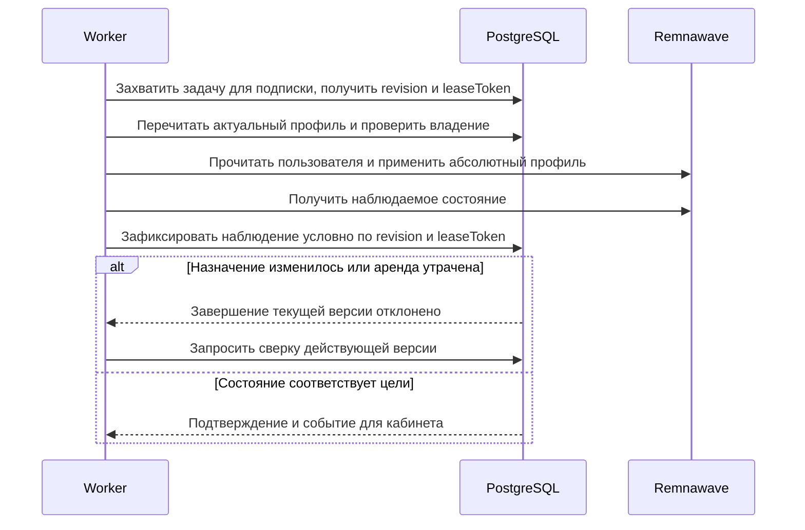

# Подписки, периоды и выдача Remnawave

**Предлагаемая политика для первой версии** — одна подписка на аккаунт, ручная покупка 1, 3 или 6 календарных месяцев. Один и тот же пользователь панели обслуживает последовательные периоды. Дата платежа у провайдера определяет допустимость зачёта по заказу. Время начисления определяет расчёт сервисного периода. Их хранение раздельно позволяет объяснить задержанную активацию. [Архитектура](architecture.md) · [Признание денег](payments.md)

## Четыре представления одной покупки

| Слой | Авторитетная запись | На какой вопрос отвечает |
|---|---|---|
| Финансы | Проверенный PaymentTransaction, OrderAllocation и последующие денежные движения | Сколько денег поступило, в какой валюте, от кого, сколько возвращено? |
| Право | PeriodGrant, Adjustment, ServiceHold и снимок условий заказа | Какой интервал, устройства и ограничения принадлежат клиенту по договорённости? |
| Желаемое состояние | DesiredAssignment с монотонной revision, интервалом действия, признаком доступа, expireAt, лимитами и назначениями | Что магазин намерен применить в панели сейчас? |
| Подтверждённое состояние | PanelObservation с panelInstance, внешним ID, фактическими status, expireAt, лимитами, временем чтения и результатом сравнения | Что панель действительно показывала в последний раз? |

Порядок локальных наблюдений фиксируется номером попытки и временем принятия результата. Каждое наблюдение можно хранить для диагностики. В указатель актуального подтверждения попадает только результат текущей версии и действующей попытки. Метка matchedRevision выставляется магазином после сравнения всех управляемых полей. Она не является версией, удостоверенной Remnawave. Старое подтверждение в кабинете всегда сопровождается временем проверки. Историю финансов не меняет ни одно состояние панели.

## Начисление и календарь

1. Для зачтённого capture координатор в транзакции берёт заказ, затем подписку. При отсутствии подписки создаёт единственную строку на userId с обработкой конфликта. Для покупки создаётся PeriodGrant с уникальным orderId. Повтор команды читает уже записанные границы и условия. Для компенсации и импорта используются отдельные уникальные ключи источника.
2. Сериализованное время начисления берётся с часов БД после захвата подписки и сохраняется один раз. Пусть T — это время, E — конец последнего уже обещанного действующего или будущего периода. Проектное правило: начало нового периода равно max(T, E), для пустой истории — T. Окончание равно addMonthsUTC(начало, months). Интервал полуоткрытый [start, end). Время суток и доля секунды сохраняются, число месяца ограничивается последним днём целевого месяца. Интервал заказа никогда не рассчитывается повторно от ответа панели.
3. Каждая покупка рассчитывается от конца предыдущей по порядку локального зачёта. При отсутствии иных корректировок две отдельные покупки дают два последовательных периода, replay любого заказа даёт ноль дополнительных периодов. Смена тарифа, цены или устройства в каталоге не меняет старый снимок.
4. В той же транзакции записываются grant, его локальная последовательность, новая проекция назначения, задание выдачи и истории событий. Уникальность источника, запись хвоста интервалов под блокировкой и атомарный commit обеспечивают «одна покупка — одно начисление» во всех путях, включая ручное урегулирование. Ограничения БД запрещают отрицательные сроки и пересечение базовых периодов одной подписки. Корректировки ссылаются на исходный grant отдельно. Привилегии приложения исключают перезапись уже закрытой истории.
5. Предлагаемое начало оплаченного интервала первой или истёкшей подписки — момент локального зачёта. Кабинет показывает «подключаем» до подтверждения панели. Если фактическая доступность задержана, подтверждённый неоказанный интервал регистрируется как инцидент. По согласованному SLA компенсируется один раз на incidentId с решением оператора или формализованным правилом. Время первого удачного чтения после сбоя — верхняя граница задержки, а не доказательство длительности простоя. Точное правило бесплатного времени требует утверждения владельца.

| Пример UTC | Ожидаемый результат |
|---|---|
| Первая покупка 1 месяца 31.01.2028 в 10:00 | Окончание 29.02.2028 в 10:00. Для 2027 года окончание 28 февраля. |
| Действует до 31.05 в 18:00, 10.05 оплачены 3 месяца | Следующий период начинается 31.05 в 18:00 и заканчивается 31.08 в 18:00. Предоплаченные дни сохранены. |
| Истекла 01.06, начисление за 6 месяцев 10.06 в 09:30 | Новый период с 10.06 в 09:30 до 10.12 в 09:30. Дни между периодами остаются перерывом. |
| Заказ на 3 месяца с 31 января и три отдельных одномесячных заказа | При одном заказе окончание 30 апреля. При трёх в невисокосный год последовательные границы 28 февраля, 28 марта, 28 апреля. Это следствие выбранного календарного правила. Его нужно подтвердить и объяснить при продаже. |

**Изменение тарифа и лимита.** Базовый вариант — условия нового заказа вступают в силу с начала его периода. При покупке более дешёвого тарифа текущий оплаченный лимит действует до границы, при более дорогом применяется то же правило. На границе надёжно запланированная команда с уникальным (subscriptionId, boundaryTime) под блокировкой перечитывает периоды и записывает новую desiredRevision. Пропущенные границы восстанавливает периодическая выборка dueAt. Немедленный upgrade с пропорциональной доплатой требует отдельной версии правил и цены. Истёкшее предложение или неподдерживаемое панелью ограничение исключает новый checkout.

Для непрерывной цепочки периодов expireAt панели — конец непрерывного покрытия, а текущие лимиты соответствуют текущему сегменту. Для разрыва срок ограничивается ближайшим концом покрытия; в будущем запланирован отдельный запуск доступа. Уменьшить уже обещанный срок могут только явная корректировка или отзыв с основанием. Обычное продление при неизменном режиме блокировки не уменьшает ни хвост права, ни конец текущего непрерывного покрытия.

## Состояния и корректировки

| Автомат | Допустимые переходы и условия |
|---|---|
| Период | Выдача создаёт зафиксированный grant. Состояния по часам — SCHEDULED → ACTIVE → ELAPSED. Отмена будущего либо прекращение оставшейся части активного периода создают отдельный Adjustment с эффективным временем. Исходный grant и уже оказанные дни остаются в истории. |
| Право аккаунта | EMPTY → ACTIVE при начале покрытия, ACTIVE → EXPIRED на конце, EXPIRED → ACTIVE при новом периоде. Если ближайший период впереди и покрытия сейчас нет — SCHEDULED. Независимый набор активных Hold даёт эффективное BLOCKED. Снятие одного Hold пересчитывает состояние по остальным основаниям и периодам. |
| Назначение | Каждое изменение эффективного профиля либо расписания создаёт большую revision. Даже запоздалое бизнес-событие пересчитывает проекцию под блокировкой по текущей истории. Ошибка сети переводит наблюдение в устаревшее состояние; действующие условия назначения сохраняются. |
| Синхронизация | PENDING → RUNNING при захвате; RUNNING → CONFIRMED только при совпадении управляемых полей и актуальном lease. Временный сбой → RETRY_WAIT → RUNNING; неоднозначная запись → VERIFY_PENDING → RUNNING для чтения; постоянная ошибка → NEEDS_REVIEW. Устаревшая работа → SUPERSEDED. Подтверждённая версия может снова потребовать сверки при drift. |
| Наблюдение | До первого чтения UNKNOWN. Успешное чтение сохраняет действительный статус панели (ACTIVE, EXPIRED, LIMITED, DISABLED или отсутствие записи), отдельно FRESH/STALE по возрасту. Ошибка чтения сохраняет предыдущее значение и время; UI показывает просроченность, FAILED/REVIEW и оплату раздельно. |

**Возвраты и компенсации.** Полное подтверждённое возмещение до начала периода по предлагаемой политике аннулирует его. При возврате в середине периода корректируется неоказанный остаток с явно выбранного момента. Более поздние оплаченные интервалы сохраняют собственные границы и условия; разрыв отражается в расписании. Перенос будущего периода возможен отдельным согласованным действием. Частичный возврат по умолчанию меняет денежную историю; уменьшение сервиса требует решения по сумме/длительности, правила округления и привязки к конкретному grant. Возврат дублирующего незачтённого платежа сохраняет право исходного заказа. Chargeback создаёт дело и, по утверждённой политике, отдельный Hold до решения; восстановление средств снимает только Hold этого дела. Компенсация добавляет самостоятельный интервал/кредит сервиса с точной длительностью, причиной и уникальным ID, без вымышленной покупки.

**Блокировки.** Блокировка магазина немедленно ограничивает локальное получение ссылки. Для существующего устройства требуется подтверждение изменения в панели. Ручная блокировка панели — самостоятельная причина для разбирательства. При неопределённом происхождении DISABLED автоматическое включение запрещено до решения оператора. Активное право и удержание отсчитываются независимо; право на компенсацию времени удержания определяется политикой причины. Снятие блокировки перепроверяет остальные основания, актуальный срок и версию.

### Пример возврата при нескольких покупках

Клиент получил два периода по одному месяцу: [01.06, 01.07) и [01.07, 01.08). На 20.06 подтверждён полный возврат первой покупки с решением прекратить оставшийся доступ сразу. Первый grant и его историческая стоимость сохраняются, отдельная корректировка закрывает обслуживание с 20.06. Право второй покупки начинается 01.07 и завершается 01.08. Сейчас целевое состояние выключено; на 01.07 записана граница для включения с условиями второго заказа. Если панель уже ответила на прежнее продление до 01.08, этот ответ относится к старой revision. Оператор проверяет расход денег по первой оплате и наличие второй покупки независимо от результата HTTP. Если требуется перенести второй период на 20.06, это отдельное продуктовое правило с явным согласием, историей изменения и тестом.

### Хранение и повторяемость расчёта

| Сущность | Обязательные данные и барьер целостности |
|---|---|
| Subscription и PeriodGrant | Владелец, serial начисления, исходный и фактический интервал, orderId для покупки, снимок, версия правила. UNIQUE(subscriptionId, serial), уникальный источник для каждого типа grant, индекс (subscriptionId, startAt). Подписка создаётся до любых внешних вызовов. |
| Adjustment и ServiceHold | Источник и уникальный commandId, ссылка на grant или дело, effectiveAt, вид, затронутые границы и причина, автор и auditId. Hold имеет источник/основание и время снятия. Историческое чтение учитывает время вступления в силу и время записи. |
| DesiredAssignment | (subscriptionId, revision), профиль доступа и его хеш, причина, createdAt, nextBoundaryAt. Ревизия вычисляется под блокировкой. Индекс по due nextBoundaryAt обслуживает смену будущих условий. |
| PanelObservation | ID панели и пользователя, нормализованные поля и статус, момент чтения и получения, token попытки, проверяемая revision и расхождение. Хранить только нужные поля; приватный subscriptionUrl не входит в наблюдение. Уникальная привязка (panelInstance, remoteUserId) предотвращает присвоение одного VPN-аккаунта двум покупателям. |

## Worker, поздние ответы и сверка

Захват использует NOT EXISTS для предшественников до LIMIT, блокировку строк и SKIP LOCKED. У агрегата синхронизации одна действующая аренда на подписку **независимо от числа версий**. Захват/перезахват атомарно увеличивает монотонный leaseToken, выставляет владельца и leaseUntil по часам БД. Продление аренды и все переходы, включая fail и retry, проверяют subscriptionId, owner, token, срок и допустимое предыдущее состояние. Задача устаревшего снимка при появлении новой ревизии может быть свёрнута: все права до этого уже записаны. Ошибка старой задачи не должна блокировать применение актуального запрета. Ошибка актуального назначения видна оператору.

Перед HTTP исполнитель перечитывает desiredRevision и остаток аренды. Таймаут запроса ограничен, lease обновляется, повтор отправляет абсолютные управляемые поля. Для нового пользователя используется детерминированный username, сверяются panelInstance и ожидаемый внешний ID. Конфликт отображения или неожиданный внешний ID требует разбора. При неизвестном исходе создания/обновления сначала читать панель. Для expired/blocked назначений использовать поддерживаемое контрактом выключение; подтверждать отдельно статус блокировки, назначенный срок и лимит. Включать ранее отключённую запись можно только при известном разрешении на снятие именно этой блокировки. Переиспользовать короткую транзакцию фиксации результата с условным UPDATE; ноль изменённых строк означает потерю права подтверждения.

**Предел гарантии.** В изученном клиенте панели отсутствует условная запись с внешней версией или fencing token. PostgreSQL отклоняет устаревший commit, но не может отозвать HTTP-запрос, уже принятый удалённой стороной. После таймаута приоритет получает проверка результата. При неясном порядке запросов ставится флаг обязательной повторной сверки последней ревизии, в том числе если предыдущая сверка уже дала совпадение. Периодический read-back проверяет также подтверждённые подписки и ручные изменения; после восстановления связи и окончания запоздалых записей достигается сходимость. Мгновенная внешняя блокировка при сетевом разделении недостижима. Для строгой гарантии порядка удалённых записей нужен документированный условный контракт панели. [ADR 0003](adr/0003-panel-convergence.md)

## Приёмочные сценарии

| Операция и точка отказа | Восстановление | Проверяемый результат |
|---|---|---|
| Одновременно зачтены два заказа одной подписки | Блокировка строки сериализует grant и вычисление хвоста | Два непересекающихся периода и оба orderId. Повтор каждого даёт те же границы. |
| Обычное продление рядом с границей месяца, года, 29 февраля или сменой часового пояса клиента | Использовать сохранённые UTC-границы и версию правила | Точное совпадение с календарными примерами, старый оплаченный конец не уменьшается. |
| Сбой между commit начисления и запуском worker, в том числе длительный | Задача существует с той же версией; после восстановления отдельно разбирается потерянное время | Один период, одна санкционированная компенсация за инцидент; кабинет сообщает задержку. |
| Панель изменилась, worker упал до commit | Новый token, read-back, сверка полей. При совпадении подтвердить, иначе применить актуальную цель | Внешний пользователь один, срок прежний, второй grant отсутствует. |
| Возврат или блокировка во время HTTP, старая попытка пришла после новой | Отменить локальное подтверждение старой версии. После её позднего внешнего эффекта повторить сверку | Новая версия подтверждена последним наблюдением; запрещённое получение ссылки закрыто с момента локального commit. |
| Сменился тариф, процесс спал на момент границы | Обработать просроченную boundary-команду с пересчётом на текущее время | Преждевременного снижения лимита нет, действующий лимит сходится с целевым, разрыв отмечен. |
| Пропал пользователь панели, изменился ID, найден ручной запрет либо неизвестный squad | Приостановить неоднозначную запись, открыть дело, продолжать обработку других клиентов | Оператор видит основание; автоматический повтор не отменяет чужой запрет и не присваивает чужой аккаунт. |
| Нет подтверждения возврата, два администратора запросили одну компенсацию | До подтверждения денег действуют исходные правила. У компенсации один ID и аудит | Длительность не списана по таймауту, второе начисление компенсации исключено. |
| Ротация ссылки или задержка панели при чтении кабинета | Перечитать ссылку у панели только для текущего владельца; ошибка чтения не меняет историю права | Чужому и заблокированному доступ закрыт, приватный URL отсутствует в аудитах и кэшах; видна дата последней успешной проверки. |

Для допуска к реальной продаже владелец подтверждает календарную политику, правила апгрейда, компенсацию задержек, сроки ручного разбора и условия изменения права после возврата и спора. Интеграционный стенд должен подтвердить фактическое применение HWID и подключение одним тестовым устройством.
